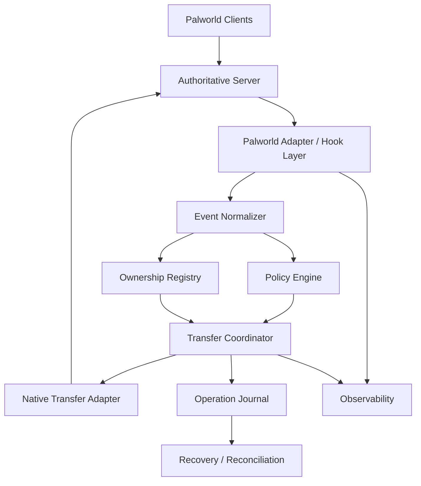

# PalHomeward architecture

The planned design isolates server integration from ownership, policy, transfer coordination and recovery. See the [domain model and invariants](plan.md#5-domain-model-and-invariants) and [persistence, recovery and backup rules](plan.md#7-persistence-consistency-recovery-and-backups).

## Component view



## Separation of responsibilities

| Component | Input | Output | Constraint |
|---|---|---|---|
| `main.lua` | UE4SS startup | Module and hook registration | No business logic |
| `probe.lua` | Runtime signals | Structured logs | Read-only |
| `palworld_adapter.lua` | `UObject`, RPC, parameters | Normalized events | Contains all engine calls |
| `ownership.lua` | Verified instance data | Owner or `UNRESOLVED` | No access to Unreal objects |
| `policy.lua` | Request, owner, permissions, destination | `ALLOW`, `REDIRECT`, `DENY` | Deterministic and testable |
| `transfer.lua` | Authorized decision | Transactional state | Prevents duplicate operations |
| `journal.lua` | Operation event | Durable, validated record | Never assume `fsync` exists |
| `reconcile.lua` | Journal and runtime snapshot | Confirmed, pending or anomalous | Never correct data blindly |
| `compatibility.lua` | Versions and capabilities | Safe mode | Mutations disabled without evidence |
| `logging.lua` | Events and error codes | JSONL/console | Excludes secrets |

## Domain API: normative pseudocode

> **Non-executable pseudocode.** The `native.*` methods are adapter interfaces to be implemented. Never present them as real Palworld functions.

```text
handleWorkerRemoval(request):
  require serverAuthority() == true
  require capability("PRE_MUTATION_INTERCEPTION") == VERIFIED
  require capability("CANCEL_OR_REDIRECT") == VERIFIED

  request = normalizeAndValidate(request)
  assert request.worldId == currentWorldId

  with perPalLock(request.palInstanceId):
    if journal.hasCompleted(request.operationId):
      return journal.previousResult(request.operationId)

    state = native.readFreshState(request.palInstanceId)
    if not state.isWorkerIn(request.baseId, request.sourceSlot):
      return DENY("SOURCE_CHANGED")

    owner = ownership.resolveVerifiedOwner(state, registry)
    if owner is UNRESOLVED:
      return DENY("UNKNOWN_OWNER")

    assert actorMayManageWorkers(request.actorUid, request.baseId)
    destination = native.resolveOwnerPersonalStorage(owner)

    if not native.canSafelyAccept(destination, state):
      return DENY("DESTINATION_NOT_AVAILABLE")

    journal.recordPrepared(request, owner, source, destination)
    outcome = native.executeVerifiedMoveOnce(state, destination)

    finalState = native.readFreshState(request.palInstanceId)
    if outcome and finalState.isOnlyAt(destination):
      journal.recordConfirmed(...)
      return SUCCESS

    journal.recordUncertain(...)
    return STOP_AND_RECONCILE
```

## Hook rules

`RegisterHook` takes a `UFunction` path and callbacks. The documentation distinguishes PRE from POST and separates replacement of the *return value* from cancellation of the original function body. **A hook's return value does not prove that a transfer was cancelled.** Never make `return false` mean “cancel” in code without in-game evidence. [UE-01]

- Register once, check that the function already exists and release hooks where appropriate.
- Normalize `UObject` and `RemoteUnrealParam` references to simple data. Never retain references beyond their verified lifetime.
- Access engine objects on the correct thread according to the API and measured behavior. Keep blocking disk I/O out of critical callbacks.
- Prevent reentrant loops. A return initiated by PalHomeward may trigger movement hooks again.
- Isolate actual names and paths in the adapter for revalidation after updates.

## Result codes

```text
OK_RETURNED_TO_OWNER
OK_OWNER_SELF_REMOVAL
DENY_UNKNOWN_PAL
DENY_UNKNOWN_OWNER
DENY_UNAUTHORIZED_ACTOR
DENY_SOURCE_CHANGED
DENY_OWNER_STORAGE_UNAVAILABLE
DENY_DESTINATION_FULL
DENY_CONCURRENT_OPERATION
DENY_UNSUPPORTED_TRANSFER_PATH
ERROR_HOOK_NOT_VERIFIED
ERROR_NATIVE_TRANSFER_FAILED
ERROR_PERSISTENCE_FAILED
ERROR_RECONCILIATION_REQUIRED
ERROR_GAME_BUILD_UNSUPPORTED
```

Every response includes `operationId`, `worldId`, `palInstanceId`, a code and a decision. The IDs can be pseudonymized in logs. Use the server's final state to prove movement. A message alone is insufficient.
