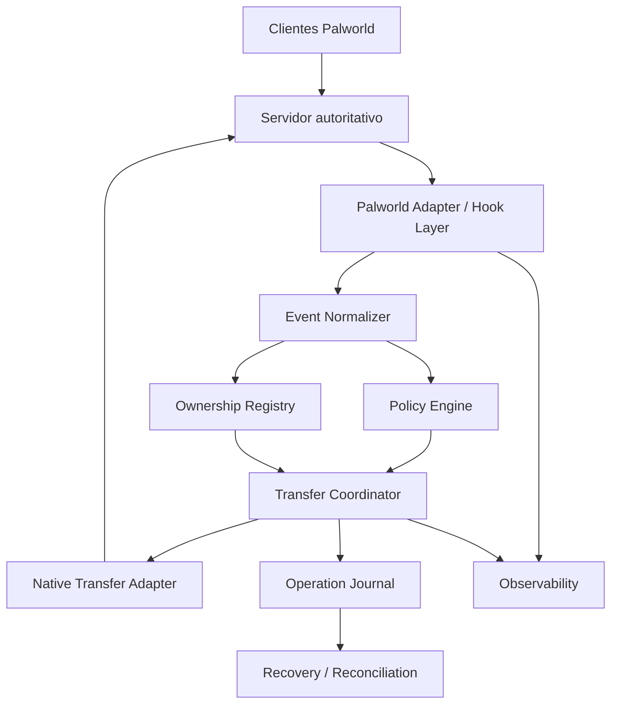

# PalHomeward — Plan maestro de desarrollo, pruebas y validación

> **Proyecto:** PalHomeward  
> **Versión de este plan:** 1.0  
> **Fecha de elaboración y revisión de fuentes:** 22 de noviembre de 2026  
> **Objetivo de producto:** PalHomeward 0.1.0 (MVP)  
> **Idioma operativo:** español; código, identificadores y mensajes técnicos en inglés  
> **Política predeterminada:** `AUTO_RETURN` — devolución automática al propietario  
> **Estrategia de ejecución:** implementación asistida por IA agéntica, con *gates* verificables y evidencias reproducibles  
> **Estado:** **PLAN / NO IMPLEMENTADO**. Ningún hook de retirada, API de movimiento o resultado de pruebas del juego se considera verificado por el mero hecho de aparecer en este documento.

---

## Índice

1. [Propósito y contrato del proyecto](#1-propósito-y-contrato-del-proyecto)
2. [Evidencias, supuestos y preguntas abiertas](#2-evidencias-supuestos-y-preguntas-abiertas)
3. [Alcance, experiencia de usuario y requisitos](#3-alcance-experiencia-de-usuario-y-requisitos)
4. [Decisiones tecnológicas y entorno](#4-decisiones-tecnológicas-y-entorno)
5. [Modelo de dominio y reglas invariantes](#5-modelo-de-dominio-y-reglas-invariantes)
6. [Arquitectura y contratos internos](#6-arquitectura-y-contratos-internos)
7. [Persistencia, consistencia, recuperación y copias](#7-persistencia-consistencia-recuperación-y-copias)
8. [Investigación de hooks y protocolo de descubrimiento](#8-investigación-de-hooks-y-protocolo-de-descubrimiento)
9. [Plan detallado por fases y condiciones de superación](#9-plan-detallado-por-fases-y-condiciones-de-superación)
10. [Catálogo de pruebas unitarias y de propiedades](#10-catálogo-de-pruebas-unitarias-y-de-propiedades)
11. [Pruebas de integración, multijugador y fallos](#11-pruebas-de-integración-multijugador-y-fallos)
12. [Rendimiento, compatibilidad y regresión](#12-rendimiento-compatibilidad-y-regresión)
13. [Procedimiento de desarrollo con IA agéntica](#13-procedimiento-de-desarrollo-con-ia-agéntica)
14. [CI, evidencias, revisión y criterios de publicación](#14-ci-evidencias-revisión-y-criterios-de-publicación)
15. [Estructura del repositorio y configuración inicial](#15-estructura-del-repositorio-y-configuración-inicial)
16. [Primeras tareas que debe ejecutar el agente](#16-primeras-tareas-que-debe-ejecutar-el-agente)
17. [Riesgos, alternativas y decisiones pendientes](#17-riesgos-alternativas-y-decisiones-pendientes)
18. [Referencias y trazabilidad](#18-referencias-y-trazabilidad)
19. [Anexos: plantillas operativas](#19-anexos-plantillas-operativas)

---

## 1. Propósito y contrato del proyecto

### 1.1. Problema

En Palworld, varios miembros de un mismo gremio pueden trabajar sobre una base común. Su almacenamiento personal de Pals y los espacios de trabajadores de una base no tienen necesariamente las mismas reglas de propiedad. En particular, al sacar de una base un Pal que aportó otro compañero, es posible que termine en el almacenamiento del jugador que lo retiró. Eso genera confusión, pérdidas temporales de acceso y situaciones no deseadas tras una desconexión o un cambio de gremio.

La petición aparece en debates de usuarios: piden que un trabajador devuelto desde una base vaya al propietario original, no a quien lo reorganizó. Véanse las referencias [COM-01], [COM-02], [COM-03] y [COM-04]. **Los foros describen experiencias de usuarios; no constituyen documentación de la API ni garantía de que la mecánica sea idéntica en todas las versiones.**

### 1.2. Resultado esperado

Ejemplo base:

1. El jugador **A** es propietario de un Foxparks identificado por una instancia única `pal-001`.
2. A asigna `pal-001` a una base compartida con el jugador **B**.
3. B desea reemplazarlo y solicita retirarlo, desde el Palbox o desde otra interfaz del juego.
4. PalHomeward determina que la propiedad legítima sigue siendo de A.
5. **Si existe un mecanismo nativo y seguro de redirección**, el Pal se envía al almacenamiento personal válido de A, aunque B sea quien lo retire.
6. El Foxparks mantiene su misma identidad y atributos; B no adquiere su propiedad; ambos siguen pudiendo colaborar normalmente.

La acción debe resultar *seamless* desde el punto de vista del jugador: idealmente sin diálogos extra, sin una segunda interfaz de inventario y sin alterar la IA de trabajo.

### 1.3. Condición fundamental de seguridad

**Prohibido crear, destruir, clonar o reescribir directamente un Pal como método habitual de devolución.** Se priorizarán operaciones legítimas del servidor. Si el motor no proporciona una operación interceptable o redirigible de forma segura, el MVP **no** debe anunciar devolución automática funcional; deberá permanecer en modo observación o protección validada.

### 1.4. Prioridades, por orden

1. Integridad del guardado y ausencia de pérdidas/duplicados.
2. Identificación fiable del propietario y de la instancia.
3. Autoridad del servidor: clientes no deciden por sí solos el destino.
4. Funcionamiento con el propietario desconectado, **si la API lo permite**.
5. Compatibilidad con el flujo normal de trabajo y transferencias.
6. Transparencia visual y mínima configuración.
7. Rendimiento, mantenibilidad y adaptación a actualizaciones.

### 1.5. Definición de «terminado»

PalHomeward 0.1.0 estará terminado únicamente cuando se cumplan **todos** los criterios de los *gates* G0–G8 descritos en la sección 9 y 14. El documento, las pruebas unitarias simuladas o la presencia de un archivo `.lua` no equivalen a una implementación verificada.

---

## 2. Evidencias, supuestos y preguntas abiertas

### 2.1. Hechos documentados

| ID | Afirmación | Confianza | Evidencia |
|---|---|---|---|
| DOC-01 | El sistema oficial de mods del servidor dedicado está documentado para **Windows**; Pocketpair advierte del riesgo de corrupción de guardados. | Alta, según documentación oficial consultada | [OF-01] |
| DOC-02 | El cargador oficial admite mods Lua/UE4SS y usa un paquete `Info.json` con `InstallRule`; un mod de servidor debe declarar `IsServer: true`. | Alta | [OF-02], [OF-03] |
| DOC-03 | UE4SS implementa `RegisterHook` para funciones Unreal cargadas; **un callback no implica poder cancelar la función original**. | Alta respecto a la API documentada | [UE-01] |
| DOC-04 | En UE4SS, el comportamiento pre/post de `RegisterHook` depende de la función; los callbacks adicionales no siempre tienen las mismas capacidades. | Alta | [UE-01] |
| DOC-05 | Existen proyectos UE4SS para Palworld que observan objetos, bases y trabajadores. | Alta, solo respecto a dichos proyectos | [REF-01], [REF-02] |
| DOC-06 | Herramientas de guardado documentan campos como `PlayerUId`, `InstanceId` y `PalStorageContainerId`; no son automáticamente equivalentes a una API online de propiedad. | Alta como referencia de estructura guardada, no de runtime | [SAVE-01] |
| DOC-07 | Hay implementaciones Linux comunitarias experimentales, pero no sustituyen la compatibilidad oficial Windows ni están validadas para este mod. | Alta respecto al estado declarado por los proyectos | [LIN-01], [LIN-02] |

### 2.2. Supuestos **no verificados**: tratarlos como tareas de investigación

- **H-01:** existe una función del servidor que procesa las retiradas de trabajadores y puede interceptarse antes de modificar los contenedores.
- **H-02:** la retirada puede rechazarse o redirigirse sin provocar una operación residual posterior del juego.
- **H-03:** una instancia de Pal conserva un identificador estable en todos los cambios de almacenamiento previstos.
- **H-04:** hay suficiente información nativa para determinar al propietario legítimo de Pals ya asignados cuando se instala el mod.
- **H-05:** se puede acceder o transferir a un Palbox personal cuyo propietario está desconectado.
- **H-06:** existen comprobaciones de capacidad, slots reservados y estados bloqueados que pueden realizarse sin condiciones de carrera.
- **H-07:** todos los caminos de retirada (Palbox, menú de base, mods de terceros, automatizaciones) pasan por la misma función validable, o por un conjunto pequeño de puntos que podemos cubrir.
- **H-08:** se puede conservar la propiedad legítima en operaciones de comercio, breeding, despido, liberación, venta, cambios de gremio o transferencia voluntaria sin confundirlas con una retirada de trabajador.

**Instrucción para agentes:** jamás convertir estas hipótesis en afirmaciones de implementación por deducción, intuición o similitud de nombres. Registrar la prueba, build, logs y función exacta o marcar `UNVERIFIED`.

### 2.3. Preguntas bloqueantes para la fase 0

| Pregunta | Evidencia necesaria | Bloquea |
|---|---|---|
| ¿Qué `UFunction`/RPC recibe la retirada? | Ruta exacta, clase, parámetros, llamada observada en servidor | G2 |
| ¿El hook es PRE o POST? | Traza de orden con un cambio de contenedor observable | G2 |
| ¿Puede cancelarse realmente? | Retirada rechazada sin alterar ninguno de los dos contenedores | G5 |
| ¿Puede sustituirse el destino nativamente? | Retirada redirigida en una copia desechable, sin doble ejecución | G6 |
| ¿Cuál es la identidad estable del Pal? | Correlación entre runtime y guardado antes/después | G3 |
| ¿Cómo reconocer al propietario original? | Fuente autoritativa y casos ambiguos documentados | G3 |
| ¿Cómo tratar al propietario offline? | Prueba del servidor con A desconectado y B conectado | G6/G7 |

### 2.4. Regla de versiones

Al iniciar cada ciclo experimental, almacenar en `docs/compatibility.md`:

```text
Palworld client version:       <EXACT_VERSION>
Palworld dedicated version:    <EXACT_VERSION>
Steam build ID (server):       <EXACT_BUILD_ID>
UE4SS distribution/version:    <EXACT_TAG_OR_COMMIT>
PalHomeward git commit:           <GIT_SHA>
Operating system:             <WINDOWS_VERSION>
Package installation method:  <MANUAL|OFFICIAL_LOADER>
Test world snapshot hash:     <SHA256_OR_MANIFEST>
```

No afirmar «compatible con 1.0» si no se ha probado la **subversión concreta** y su build. Tras una actualización del juego se reabre G2–G8 según el nivel de impacto.

---

## 3. Alcance, experiencia de usuario y requisitos

### 3.1. Dentro del MVP 0.1

- Un solo gremio con dos o más miembros, y una o varias bases compartidas.
- Propiedad individual persistente de un Pal identificado por su instancia.
- Retirada de un trabajador ajeno y devolución a su propietario, **con flujo nativo verificado**.
- Retirada propia sin cambio inesperado de propiedad.
- Gestión segura de destinos sin espacio, offline o no resolubles.
- Exclusión mutua para solicitudes concurrentes sobre la misma instancia.
- Registro mínimo de operaciones, reconciliación y diagnósticos.
- Modo observación y modo de protección experimental para laboratorios.
- Instalación documentada en servidor dedicado **Windows**.
- Restauración limpia de copias del mundo, desactivación y recuperación.

### 3.2. Fuera del MVP 0.1

- Filtrado visual del Palbox y cliente modificado.
- Ocultar a los jugadores los Pals físicos de otros miembros.
- Sistema completo de préstamos, contratos o comercio.
- Migración automática de Pals con propiedad histórica ambigua.
- Recuperación automática masiva al abandonar un gremio; inicialmente solo se documentará el riesgo.
- Soporte garantizado para Linux, sesiones P2P o Game Pass/Microsoft Store.
- Edición directa de guardados en caliente.
- Reescritura de rutas de IA, tareas y comportamiento de trabajadores.
- Compatibilidad automática con todos los mods de terceros.

### 3.3. Requisitos funcionales (RF)

| ID | Requisito observable | Prioridad | Evidencia mínima |
|---|---|---|---|
| RF-01 | Identificar un Pal por instancia, sin confundir Pals de la misma especie. | P0 | Prueba A/B con 2 Pals idénticos |
| RF-02 | Resolver propietario mediante fuente verificada o registro fiable. | P0 | Log de origen y comparativa con el juego |
| RF-03 | Mantener dueño al asignarlo como trabajador. | P0 | Owner UID antes/después |
| RF-04 | Retirar Pal propio con el flujo habitual. | P0 | IT-02 |
| RF-05 | Retirar Pal ajeno y enviarlo a almacenamiento de su dueño. | P0 | IT-01 |
| RF-06 | No permitir apropiación accidental mediante otra UI cubierta. | P0 | IT-09/IT-10 |
| RF-07 | Rechazar o dejar sin completar acciones ambiguas sin destruir datos. | P0 | Unitarios + IT-11 |
| RF-08 | Procesar dueño desconectado cuando exista mecanismo soportado. | P0 condicionado | IT-03; si imposible, **no liberar MVP con promesa de offline** |
| RF-09 | No duplicar un Pal ante dos retiradas concurrentes o repetidas. | P0 | IT-05/IT-06 |
| RF-10 | Conservar propietario tras reinicio. | P0 | IT-07 |
| RF-11 | Reconciliar operaciones incompletas sin repetir a ciegas. | P0 | IT-08 |
| RF-12 | Operar en modo `OBSERVE` sin mutaciones de contenedores. | P0 | IT-00 |
| RF-13 | Mantener registro auditable de decisiones y errores. | P1 | Logs de pruebas |
| RF-14 | Permitir desactivar PalHomeward y conservar el guardado nativo. | P0 | IT-18 |
| RF-15 | No reasignar propiedad por abrir una UI o por estar cerca de un Pal. | P0 | Unitario de eventos irrelevantes |
| RF-16 | Permitir automatizar pruebas sin ejecutar el juego para la lógica pura. | P1 | `pytest`/tests Lua |

**Importante:** la no disponibilidad del propietario offline puede ser una limitación real del motor. No se sustituirá silenciosamente por «guardar en el Palbox del actor». La aceptación de una política alternativa exige modificar expresamente este plan y el alcance de la versión.

### 3.4. Requisitos no funcionales (RNF)

| ID | Requisito | Condición medible |
|---|---|---|
| RNF-01 | Integridad de identidad | 0 instancias duplicadas o desaparecidas en pruebas obligatorias |
| RNF-02 | Conservación de atributos | Hash/instantánea equivalente para estado lógico del Pal; excluir campos volátiles justificados |
| RNF-03 | Autoridad | Ninguna mutación causada exclusivamente por datos de propiedad suministrados por un cliente |
| RNF-04 | Tolerancia a cambios | Ante hook desconocido o versión no validada, desactivar mutaciones y emitir diagnóstico |
| RNF-05 | Arranque y parada | Se puede desactivar sin edición manual del `.sav` |
| RNF-06 | Latencia | Registrar p50/p95/p99 y comparar con vanilla; umbral de liberación provisional: sobrecoste p95 ≤ 10 ms en una retirada, medido localmente en el mismo entorno |
| RNF-07 | Logs | Conservar causa, operación, tipo de fallo y correlación; evitar contraseñas, tokens y datos sensibles |
| RNF-08 | Reproducibilidad | Documentar build, versión, pasos y salida exacta de cada test |
| RNF-09 | Mantenimiento | Lógica de dominio separada del adaptador Unreal, al menos 90 % de decisiones de propiedad cubiertas por pruebas de ramas |
| RNF-10 | Dependencias | Versiones y licencias revisadas; no copiar código de proyectos con licencias incompatibles |

Los objetivos de rendimiento son **umbrales de proyecto a validar con mediciones**, no características ya probadas.

### 3.5. Historias de usuario y criterios de aceptación

**US-01 — Reorganización natural.** Como jugador B, quiero sustituir trabajadores de A sin quedarme con sus Pals. **Aceptación:** al sustituir `pal-001` se encuentra únicamente en el contenedor correcto de A, con sus atributos conservados; el Pal sustituto queda asignado correctamente.

**US-02 — Independencia de conexión.** Como A, quiero que mis trabajadores sigan en la base mientras estoy desconectado y que me los devuelvan sin necesidad de entrar. **Aceptación:** A se desconecta, B retira un trabajador, A vuelve a conectarse y recupera la misma instancia sin negociación manual; sujeto a G6 de compatibilidad offline.

**US-03 — Protección por defecto.** Como administrador, quiero que los casos sin propietario fiable o sin destino seguro se rechacen antes de cambiar contenedores. **Aceptación:** el Pal sigue donde estaba y existe un mensaje trazable.

**US-04 — Desinstalación no destructiva.** Como administrador, quiero volver a vanilla. **Aceptación:** tras parada limpia y desactivación del mod, la partida carga y sus Pals siguen disponibles; no se requiere el mod para interpretar copias creadas durante sus operaciones confirmadas.

---

## 4. Decisiones tecnológicas y entorno

### 4.1. Ruta principal (soportada documentalmente)

- **Servidor:** Palworld Dedicated Server para Windows.
- **Cargador:** mecanismo oficial de mods + UE4SS compatible con la build concreta.
- **Integración:** scripts Lua; C++/hook nativo solo si una investigación formal demuestra que Lua no puede interceptar una operación necesaria.
- **Datos auxiliares:** JSON y registro de operaciones (solo cuando se compruebe una escritura fiable desde el runtime); si no, considerar una biblioteca nativa controlada y documentada.
- **Lógica testable:** módulos Lua puros; Python `pytest` como arnés para escenarios de contrato y utilidades de informes. El comportamiento real se verifica además con Lua y con el servidor.
- **IDE:** VS Code/IntelliJ con soporte Lua. **SCM:** Git.

**Nota:** el cargador oficial de mods no es una API de transferencias de Pals. Permite cargar código, no garantiza los hooks funcionales necesarios [OF-02, UE-01].

### 4.2. Entornos mínimos

| Entorno | Objetivo | Datos admitidos |
|---|---|---|
| E0 — offline | Tests puros Lua/Python, lint, esquema y escenarios simulados | Solo fixtures inventados |
| E1 — Windows laboratorio | Dedicado con UE4SS y un mundo desechable | Guardados nuevos o copias explícitas |
| E2 — Multijugador | E1 + dos clientes con cuentas distintas y un mismo gremio | Mundo desechable versionado |
| E3 — Validación | Misma build, mundo recién restaurado, configuración fija | Snapshot «golden» inalterable |
| E4 — Linux experimental | Investigar portabilidad tras tener un MVP Windows estable | Nunca guardar de producción |

No usar la partida habitual de los jugadores ni el servidor doméstico de producción para las primeras pruebas de escritura.

### 4.3. Preparación del laboratorio Windows

1. Instalar Palworld Dedicated Server en Windows según [OF-04].
2. Arrancarlo **sin mods** y confirmar que dos jugadores pueden entrar y salir; registrar versión y build.
3. Crear una partida nueva, guardar, detener el servidor limpiamente y generar un **snapshot completo** del directorio de guardado y configuración. No copiar únicamente `Level.sav`; el formato incluye datos por jugador y almacenamiento adicional [SAVE-01].
4. Calcular hash o manifiesto SHA-256 de ese snapshot; almacenarlo fuera del directorio activo.
5. Instalar/activar el loader y UE4SS siguiendo [OF-01] y [UE-02]. Nunca asumir que una instalación antigua con proxy DLL y la instalación gestionada por Workshop son idénticas.
6. Generar el paquete de desarrollo mediante el uploader oficial o un paquete que respete estrictamente su formato; validar `Info.json`.
7. En `Mods/PalModSettings.ini`, activar los `PackageName` correctos, `bGlobalEnableMod=true` y reiniciar. Comprobar la instalación efectiva y logs; una carpeta copiada no basta [OF-01].
8. Ejecutar un `main.lua` que solo imprima un marcador de arranque; no instalar hooks de mutación todavía.
9. Confirmar que **un único** registro de arranque aparece por lanzamiento. Si hay cargas repetidas, resolver la configuración antes de avanzar.
10. Archivar el manifiesto `environment.json` con versiones, hash, método de instalación y ubicación de logs.

El loader oficial usa `InstallRule` (singular), admite reglas `Type: "Lua"` e instalación de servidor con `IsServer: true`. Para un ejemplo actualizado debe partirse del fichero generado por el uploader [OF-03], no de una plantilla fabricada sin validar.

### 4.4. Desactivación y línea de recuperación

- Detener el servidor de forma ordenada y confirmar que terminó de guardar.
- Copiar guardado actual y datos auxiliares de PalHomeward por separado.
- Desactivar `PackageName` en `ActiveModList` y reiniciar; `-NoMods` es una opción de emergencia documentada, **no** un mecanismo de reconciliación de operaciones pendientes [OF-01].
- Si hay operaciones `PREPARED`/`UNCERTAIN`, mantener el servidor cerrado y ejecutar protocolo de análisis: restaurar un snapshot coherente si procede. Nunca «reparar» duplicados borrando Pals automáticamente.

### 4.5. Linux y Steam Deck: investigación posterior

- Linux no forma parte de la ruta oficial de servidor moddeado de Pocketpair a fecha de revisión [OF-01].
- Hay proyectos comunitarios experimentales con hooks/UE4SS o frameworks alternativos en Linux [LIN-01, LIN-02]. Deben tratarse como **un nuevo backend**, con pruebas completas de paridad, seguridad y licencias.
- Steam Deck se puede utilizar como cliente en experimentos posteriores, pero no se presupone que su cliente necesite ni soporte la misma instalación del mod. La primera iteración prioriza lógica autoritativa del servidor sin UI adicional.

---

## 5. Modelo de dominio y reglas invariantes

### 5.1. Términos

- **PalInstanceId:** identificador estable de una criatura individual **verificado** para la build actual; no su especie ni nombre.
- **OwnerUid:** jugador propietario original/legítimo según reglas explícitas.
- **ActorUid:** jugador que solicitó mover al trabajador.
- **SourceContainerId:** contenedor o slot en el que está actualmente.
- **DestinationContainerId:** contenedor destino autorizado.
- **BaseId/GuildId:** contexto de operación, no pruebas de propiedad.
- **NativeTransfer:** llamada o secuencia del juego que el servidor procesa y confirma.
- **WorldId:** identificador de mundo que delimita el registro; la misma instancia numérica en otro mundo no debe colisionar.
- **OperationId:** token único de correlación/idempotencia generado por PalHomeward.

Los nombres son **contratos internos**, no afirmaciones sobre nombres exactos de miembros de Unreal.

### 5.2. Reglas invariantes (INV)

| ID | Invariante | Cómo se comprueba |
|---|---|---|
| INV-01 | Una instancia de Pal tiene **un** estado/ubicación autoritativa a la vez dentro del ámbito cubierto. | Conteo de referencias y consulta runtime |
| INV-02 | La retirada de trabajador no cambia `OwnerUid`. | Comparación pre/post |
| INV-03 | Una solicitud ambigua nunca se «arregla» eligiendo al `ActorUid` como dueño. | Tests desconocidos y fallos |
| INV-04 | La misma solicitud `OperationId` no ejecuta dos movimientos. | Duplicación/reintento |
| INV-05 | El actor no puede especificar un propietario arbitrario para forzar una transferencia. | Test de actor malicioso/cliente manipulado |
| INV-06 | No hay movimiento confirmado sin validación actual del origen y el destino. | Test de estado cambiado |
| INV-07 | El estado `CONFIRMED` procede de comprobar el juego, no solo de recibir un «OK». | Test respuesta falsa |
| INV-08 | Si el registro y el juego discrepan, se declara `RECONCILIATION_REQUIRED`. | Test de crash |
| INV-09 | Un mod desactivado no deja el mundo dependiendo de contenedores ficticios. | Desinstalación |
| INV-10 | Ninguna decisión de producto se basa en un hook inventado o sin evidencia. | Auditoría de `hook-catalog.md` |

**Matiz de INV-01:** pueden existir referencias auxiliares, índices o representaciones de serialización; lo prohibido son **dos posiciones jugables activas** para la misma instancia en el mismo estado del mundo.

### 5.3. Origen de la propiedad

1. Preferir una fuente nativa, explícita y estable **solo si se demuestra que significa propiedad y no «último jugador que movió»**.
2. Para Pals asignados después de activar el mod, registrar la propiedad en un evento cuya semántica haya sido contrastada.
3. Los Pals ya presentes en bases al instalar el mod pueden tener propiedad ambigua. **No inferirla por orden de slots, nombre o cercanía.**
4. Para registros ambiguos: estado `UNRESOLVED`, no habilitar `AUTO_RETURN` de ese Pal y mostrar guía de migración segura manual.
5. Transferencias voluntarias entre jugadores son **otro flujo**. En el MVP, si no se puede reconocer ese flujo de forma fiable, se evita interceptarlo; no reescribir automáticamente un dueño legítimamente transferido.
6. Nunca utilizar un UUID del cliente como prueba de identidad sin corroboración del lado del servidor.

### 5.4. Transiciones lógicas

```text
WORKING(owner=A, base=X)
    -- solicitud B de retirada --> VALIDATING
    -- origen, destino, propietario OK --> RESERVED
    -- operación nativa confirmada --> IN_OWNER_STORAGE(owner=A)
    -- error antes de modificar --> WORKING(owner=A, base=X)
    -- estado no verificable --> RECONCILIATION_REQUIRED

Si A retira su propio Pal, destino normal = almacenamiento de A.
```

**Estados transitorios** `VALIDATING` y `RESERVED` son internos de PalHomeward; no reemplazan estados del motor. No habrá un contenedor «virtual» inventado para devolver criaturas en la primera versión.

### 5.5. Política de validación de destino

Antes de autorizar:

- Existe `WorldId` compatible y la instancia pertenece a ese mundo.
- El Pal está de verdad en un slot de trabajo autorizado y coincide con la solicitud.
- La propiedad está validada y no hay conflicto de versión/revisión.
- Se localiza **el contenedor personal correcto del dueño**, no simplemente un primer Palbox visible.
- El destino admite el Pal, tiene espacio real y no se encuentra bloqueado por otra operación.
- El jugador actor tiene permiso de reorganizar esa base según las reglas del juego.
- La solicitud mantiene coherencia con estado y operaciones concurrentes.

Cuando no se pueda comprobar cualquiera de estos puntos, no se permite un movimiento especulativo. Si el hook no permite cancelación previa, **no activar el modo de protección** con promesa de seguridad; se deja el mod en observación.

---

## 6. Arquitectura y contratos internos

### 6.1. Vista de componentes



### 6.2. Separación de responsabilidades

| Componente | Entrada | Salida | Restricción |
|---|---|---|---|
| `main.lua` | Inicio UE4SS | Registro de módulos/hook | No lógica de negocio |
| `probe.lua` | Señales runtime | Logs estructurados | Solo lectura |
| `palworld_adapter.lua` | `UObject`, RPC, params | Eventos normalizados | Todas las llamadas al motor aquí |
| `ownership.lua` | Datos verificados de instancias | Owner o `UNRESOLVED` | No tocar objetos Unreal |
| `policy.lua` | Solicitud, dueño, permisos, destino | `ALLOW`, `REDIRECT`, `DENY` | Determinista y testeable |
| `transfer.lua` | Decisión autorizada | Estado transaccional | No duplicar operaciones |
| `journal.lua` | Evento de operación | Registro durable/validado | Nunca asumir `fsync` si no existe |
| `reconcile.lua` | Journal + snapshot runtime | Confirmado/pendiente/anómalo | No corregir datos a ciegas |
| `compatibility.lua` | Versiones y capacidades | Modo seguro | Mutaciones desactivadas sin pruebas |
| `logging.lua` | Eventos y códigos de error | JSONL/console | Sin información secreta |

### 6.3. API del dominio: pseudocódigo normativo

> Pseudocódigo **no ejecutable**. Métodos `native.*` son adaptadores por implementar y **no** deben presentarse como funciones reales de Palworld.

```text
handleWorkerRemoval(request):
  require serverAuthority() == true
  require capability("PRE_MUTATION_INTERCEPTION") == VERIFIED
  require capability("CANCEL_OR_REDIRECT") == VERIFIED

  request = normalizeAndValidate(request)
  assert request.worldId == currentWorldId

  with perPalLock(request.palInstanceId):
    if journal.hasCompleted(request.operationId):
      return journal.previousResult(request.operationId)

    state = native.readFreshState(request.palInstanceId)
    if not state.isWorkerIn(request.baseId, request.sourceSlot):
      return DENY("SOURCE_CHANGED")

    owner = ownership.resolveVerifiedOwner(state, registry)
    if owner is UNRESOLVED:
      return DENY("UNKNOWN_OWNER")

    assert actorMayManageWorkers(request.actorUid, request.baseId)
    destination = native.resolveOwnerPersonalStorage(owner)

    if not native.canSafelyAccept(destination, state):
      return DENY("DESTINATION_NOT_AVAILABLE")

    journal.recordPrepared(request, owner, source, destination)
    outcome = native.executeVerifiedMoveOnce(state, destination)

    finalState = native.readFreshState(request.palInstanceId)
    if outcome and finalState.isOnlyAt(destination):
      journal.recordConfirmed(...)
      return SUCCESS

    journal.recordUncertain(...)
    return STOP_AND_RECONCILE
```

### 6.4. Regla de hooks

`RegisterHook` recibe una ruta `UFunction` y callbacks, pero la documentación distingue PRE/POST y la sustitución de *valor de retorno* de la cancelación del cuerpo original. **Devolver un valor desde el hook no es prueba de que se ha cancelado una transferencia** [UE-01]. Queda prohibido codificar `return false` como «cancelar» sin prueba en el juego.

- Registrarse una sola vez, comprobar que la función ya existe y liberar hooks si corresponde.
- No conservar referencias `UObject`/`RemoteUnrealParam` más allá de su vida verificada; normalizar a datos simples.
- Ejecutar acceso a objetos del motor en el hilo correcto conforme a la API y al comportamiento medido; no realizar disco bloqueante en callbacks críticos.
- Evitar bucles de reentrada: una devolución iniciada por PalHomeward puede disparar nuevamente hooks de movimiento.
- Aislar en el adaptador los nombres/rutas reales, para revalidar tras actualizaciones.

### 6.5. Códigos de resultado

```text
OK_RETURNED_TO_OWNER
OK_OWNER_SELF_REMOVAL
DENY_UNKNOWN_PAL
DENY_UNKNOWN_OWNER
DENY_UNAUTHORIZED_ACTOR
DENY_SOURCE_CHANGED
DENY_OWNER_STORAGE_UNAVAILABLE
DENY_DESTINATION_FULL
DENY_CONCURRENT_OPERATION
DENY_UNSUPPORTED_TRANSFER_PATH
ERROR_HOOK_NOT_VERIFIED
ERROR_NATIVE_TRANSFER_FAILED
ERROR_PERSISTENCE_FAILED
ERROR_RECONCILIATION_REQUIRED
ERROR_GAME_BUILD_UNSUPPORTED
```

Toda respuesta incluye `operationId`, `worldId`, `palInstanceId` (seudonimizables en logs), código y decisión. El mensaje no es una prueba suficiente de movimiento: el estado final lo determina el servidor.

---

## 7. Persistencia, consistencia, recuperación y copias

### 7.1. Ubicación y ámbito

No colocar datos modificables de PalHomeward en el directorio fuente de los scripts empaquetados: una actualización del Workshop puede reemplazarlos. Elegir una ruta de datos propia y **documentar/verificar** sus permisos y supervivencia a actualizaciones. Ruta abstracta: `<SERVER_WRITABLE_DATA>/PalHomeward/<WorldId>/`.

Propuesta:

```text
PalHomewardData/<WorldId>/
  ownership.v1.json
  transfer-journal.v1.jsonl
  compatibility.json
  diagnostics/
  checkpoints/
```

**No asumir** que Lua dispone de acceso seguro, atómico o durable al filesystem. Validar `io`, `os.rename`, el contexto de permisos y las operaciones de flush; si no se puede garantizar un diario fiable, elegir una dependencia nativa probada o reducir el MVP a modo seguro.

### 7.2. Modelo de registro propuesto

```json
{
  "schemaVersion": 1,
  "worldId": "WORLD_ID_FROM_RUNTIME",
  "gameBuild": "VERIFIED_GAME_BUILD",
  "revision": 17,
  "pals": {
    "PAL_INSTANCE_ID": {
      "ownerUid": "PLAYER_A_UID",
      "ownerEvidence": "verified_native_source",
      "ownerEvidenceRevision": 3,
      "status": "VERIFIED",
      "lastKnownBaseId": "BASE_ID",
      "lastKnownContainerId": "BASE_WORK_SLOT_CONTAINER",
      "lastSeenOperationId": "OP_ID"
    }
  }
}
```

Campos representativos del esquema **de PalHomeward**, no del guardado original. No confiar en `lastKnownContainerId` sin refrescar con el servidor.

### 7.3. Journal de transferencias

Estados válidos:

```text
NEW -> PREPARED -> EXECUTING -> CONFIRMED
                   |       |
                   +-------+--> RECONCILIATION_REQUIRED
```

- `PREPARED`: decisión validada y operación registrada, antes de invocar mutación.
- `EXECUTING`: operación iniciada; **no implica éxito**.
- `CONFIRMED`: estado final del servidor cotejado y estable.
- `RECONCILIATION_REQUIRED`: fallo, crash, discrepancia o confirmación incompleta.

**Limitación estructural:** no existe una transacción ACID compartida entre `Level.sav`, datos de jugador, datos del mod y un journal JSON, por lo que «exactly once después de un crash» no está garantizado. El diseño persigue *at-most-once execution* por solicitud durante la ejecución y reconciliación por estado real tras reinicio. Está prohibido reejecutar ciegamente una fila `PREPARED`.

### 7.4. Política de recuperación

1. Arrancar, leer versión y verificar integridad de datos auxiliares.
2. Detectar operaciones no confirmadas y desactivar temporalmente mutaciones para las instancias implicadas.
3. Consultar contenedores reales y localizar cada instancia afectada.
4. Clasificar:
   - **A:** está exactamente en destino: marcar `CONFIRMED_RECOVERED`.
   - **B:** está exactamente en origen y no se modificó: marcar `ABORTED_SAFE` tras confirmar que no hay otra operación activa.
   - **C:** no se encuentra, aparece duplicada o hay discordancia: `MANUAL_REVIEW_REQUIRED`, no mover nada.
5. Guardar diagnóstico y, cuando sea seguro, reactivar el modo configurado.
6. Conservar el log y checksum para auditoría.

### 7.5. Copias de seguridad y restauración

- Copia **coherente y en frío**: detener servidor, confirmar cierre, copiar todo el mundo y datos de PalHomeward; registrar hash, build y fecha.
- Para fallos en mitad de movimiento, utilizar **solo mundos de ensayo**; una copia tomada a mitad de escritura puede ser incoherente.
- Antes de cada experimento de escritura: crear snapshot nuevo o volver a snapshot limpio.
- Probar **restauración real**, no solo «backup creado».
- Retener en laboratorio un snapshot previo al primer mod y otro previo al ensayo de AutoReturn.
- No compartir guardados reales en repositorios públicos. Fixtures deben ser sintéticos o expresamente anonimizados.

### 7.6. Esquema y migraciones

- Toda versión de esquema incrementa `schemaVersion`; incluir rutina de lectura y migración no destructiva.
- Si llega un esquema futuro/desconocido, operar solo en `OBSERVE` y emitir error.
- No escribir un `ownership.v1.json` si falla su validación completa.
- Testear JSON truncado, doble entrada, worldID incompatible, corrupción UTF-8 y conflictos de revisión.
- Una actualización de mod **nunca** debe inferir nuevos propietarios porque falta un campo.

---

## 8. Investigación de hooks y protocolo de descubrimiento

### 8.1. Objetivo del *probe*

Construir `PalHomewardProbe` como modo **100 % observacional**: registra el flujo relacionado con trabajadores y contenedores; no mueve Pals, no modifica propiedades y no intenta cancelar llamadas. Su propósito es producir pruebas reproducibles para construir después el adaptador.

### 8.2. Fuentes de pistas (NO APIs garantizadas)

- [REF-01] `EnhancedBaseLogistics`: ejemplo real de UE4SS Lua en un dedicado y acceso a modelos/eventos de bases; su foco es logística, no propiedad.
- [REF-02] `TidyBaseInfo-PUBLIC`: contiene una acción «Send to Palbox» que usa solicitudes del servidor; útil para localizar flujos, pero **una UI cliente no demuestra que se pueda bloquear la operación del servidor**.
- [UE-01], [UE-03]: API de hooks, condiciones de registro, parámetros y ejecución en hilo de juego.
- [SAVE-01]: contraste de identidad para correlacionar observaciones con el estado guardado.

**Licencias:** antes de reutilizar código de un repositorio de referencia, inspeccionar su `LICENSE` y la licencia de archivos concretos. Si es restringida, usarlo exclusivamente para investigación conceptual y escribir código original.

### 8.3. Método de descubrimiento

1. Confirmar que el mod carga y que el proceso corresponde al servidor dedicado (no a un cliente accidental).
2. Crear dos identidades de prueba, A y B, mismo gremio, una base y dos Pals de la misma especie para probar IDs.
3. Obtener y registrar rutas/clases candidatas mediante exploración de objetos/reflexión y fuentes de referencia, con **build exacta**.
4. Para cada candidata, verificar existencia y orden de la llamada respecto al movimiento. Documentar si es PRE o POST y si corre en contexto servidor.
5. Loguear valores primitivos: `WorldId`, `PalInstanceId`, `ActorUid`, `BaseId`, `SourceContainerId`, destino solicitado, momento y thread context cuando sea comprobable.
6. Repetir las acciones: asignar; retirar propio; retirar ajeno; intercambiar dos workers; cerrar UI sin movimiento; propietaria/o desconectado.
7. Correlacionar logs con cambios observados en el Palbox, antes y después. Un evento sin cambio de inventario no es confirmación de retirada.
8. Descubrir entradas alternativas: menú Palbox, menús rápidos, mods como TidyBaseInfo, operaciones automatizadas. Registrar cobertura; no suponer que todo pasa por un mismo RPC.
9. Crear `docs/hook-catalog.md` con una ficha por función candidata.
10. Proponer un experimento de cancelación **solo cuando** haya evidencia suficiente y un snapshot desechable.

### 8.4. Plantilla de ficha de hook

```yaml
hook_id: H-001
path: "<REAL_UFUNCTION_PATH_FROM_REFLECTION>"
engine_class: "<CLASS>"
game_build: "<EXACT_BUILD>"
ue4ss_version: "<TAG>"
observed_in: "dedicated-server-windows"
callback_phase: "PRE|POST|UNKNOWN"
request_actor_source: "<VERIFIED_PATH_OR_UNKNOWN>"
pal_instance_source: "<VERIFIED_PATH_OR_UNKNOWN>"
source_container_source: "<VERIFIED_PATH_OR_UNKNOWN>"
requested_destination_source: "<VERIFIED_PATH_OR_UNKNOWN>"
can_cancel_original: "UNTESTED|YES|NO"
can_change_destination: "UNTESTED|YES|NO"
source_code_reference: "<FILE_AND_LINE_OR_NA>"
experiment_log: "<ARTIFACT_PATH>"
reproduction_steps: "<DOC_SECTION>"
confidence: "OBSERVED|CROSS_CHECKED|VERIFIED"
```

### 8.5. Distinción crítica: observar, cancelar y redirigir

Los tres son logros distintos:

- **Observación:** el callback recibe datos cuando ocurre una acción.
- **Cancelación:** el servidor no ejecuta la transferencia original y ambos contenedores mantienen su estado.
- **Redirección:** el servidor procesa la acción exactamente una vez con destino propietario y no ejecuta después el movimiento original.

No se permite pasar de observar a publicar `AutoReturn` sin demostrar las dos últimas propiedades. Una devolución **POST** (mover B→A después de que el juego moviera base→B) puede dejar ventanas de apropiación, pérdida, capacidad/carrera y crash; **no es diseño aceptable para 0.1**.

### 8.6. Si no existe un hook adecuado

**Rama de decisión obligatoria:**

- **Opción A:** localizar otra `UFunction`/RPC nativa con capacidad de interceptación.
- **Opción B:** prototipo nativo C++ con *detour* y validación de firma, threading y crash safety; requerirá un ADR, revisión de riesgo y nueva matriz de pruebas.
- **Opción C:** cambiar explícitamente el alcance a `OBSERVE` o a protección **solo si se confirma cancelación**. No falsear un resultado funcional.

La IA no debe recurrir a editar archivos `.sav` en caliente ni a clonar objetos como atajo.

---

## 9. Plan detallado por fases y condiciones de superación

### Visión general de gates

| Gate | Entrega | Qué queda demostrado | Para pasar |
|---|---|---|---|
| G0 | Repo + protocolo | Entorno y disciplina de pruebas | Fuentes, scripts, licencias, versión y `README` |
| G1 | Loader/probe básico | Lua se ejecuta en dedicado | Log firmado por build, una sola carga, sin mutaciones |
| G2 | Hook observado | Se identifica retirada real | 10/10 casos correlacionados, actor e instancia correctos |
| G3 | Propiedad estable | Dueño y Pal correctos | Casos A/B, repetidos, reinicio y ambiguos sin falsas atribuciones |
| G4 | Núcleo puro + journal | Política robusta y testeable | Todas las unitarias críticas PASS, simulaciones de fallo PASS |
| G5 | Cancelación segura | Retirada puede bloquearse | 20/20 ensayos de denegación con estado nativo intacto |
| G6 | AutoReturn nativo | Redirección real correcta | 30/30 cross-owner, own-owner, offline y capacidad según matriz |
| G7 | Concurrencia y recuperación | No duplicados ante fallos | Matriz de crash, 100 solicitudes/reintentos controlados, restauración PASS |
| G8 | Release candidate | Compatibilidad y desinstalación | Matriz completa, soak, packaging, revisión y documentación |

Los contadores son objetivos de aceptación definidos para el laboratorio, no resultados alcanzados.

### Fase F0 — Preparar repositorio, normativa e infraestructura (G0)

**Tareas:**

- [ ] Crear repositorio Git con `README.md`, `LICENSE` elegida, `.gitignore` y este plan.
- [ ] Incluir `AGENTS.md` (resumen derivado de la sección 13), `docs/decisions/`, `docs/evidence/`, `docs/compatibility.md` y `docs/hook-catalog.md`.
- [ ] Definir ramas, convención de commits y reglas de PR pequeñas.
- [ ] Añadir pruebas básicas con `pytest`, chequeo de sintaxis Lua y validación JSON.
- [ ] Documentar instalación Windows oficial y ubicación exacta de backups según laboratorio real.
- [ ] Registrar versiones de herramientas y dependencias; comprobar licencias de terceros.
- [ ] Crear fixtures sintéticos y herramienta de snapshot/hash.
- [ ] Preparar plantilla de informe para agentes.

**Salida:** commit `chore: bootstrap PalHomeward`, `docs/evidence/G0/`, CI que se ejecuta sin Palworld.

**G0 PASS si:** estructura y licencias presentes, tests de ejemplo verdes, ejecutable local verificable, documentación libre de APIs inventadas. **G0 FAIL si:** se incluyen guardados reales, dependencias sin procedencia o no se puede reproducir `pytest`.

### Fase F1 — Servidor dedicado y Hello World seguro (G1)

**Tareas:**

- [ ] Crear mundo de prueba, dos usuarios y un gremio.
- [ ] Lanzar dedicado Windows vanilla y conservar hash de snapshot.
- [ ] Instalar loader oficial y UE4SS en versiones compatibles con la build.
- [ ] Cargar `Scripts/main.lua` con únicamente `print("[PalHomeward] LOADED: OBSERVE")`.
- [ ] Verificar `Info.json` e `InstallRule` para servidor.
- [ ] Confirmar que el script está activo en servidor, no solo en cliente.
- [ ] Reiniciar 3 veces y comprobar **una** inicialización por reinicio.
- [ ] Ejecutar `-NoMods` y demostrar que el mundo vuelve a abrir sin PalHomeward.

**Evidencia:** `logs/startup-01..03`, manifiesto de build, capturas de estructura de carpetas, hashes antes/después de un ciclo sin mutación.

**G1 PASS si:** 3/3 arranques correctos, 0 excepciones UE4SS atribuibles al mod, 0 escrituras de estado del juego, restauración demostrada. **Bloqueo:** si no carga UE4SS, no avanzar al análisis de Pals.

### Fase F2 — Descubrir retirada y datos runtime (G2)

**Tareas:**

- [ ] Investigar las referencias [REF-01] y [REF-02], documentar hallazgos concretos (archivo, función, ruta y build).
- [ ] Implementar `probe.lua`, activable sin reiniciar solo si el runtime lo demuestra; si no, reiniciar.
- [ ] Registrar eventos de asignación y retirada, nunca invocar movimientos.
- [ ] Capturar y comparar datos de 10 retiradas: 4 propias, 4 ajenas, 2 sustituciones rápidas.
- [ ] Repetir con dos Pals iguales para detectar colisiones por especie/nombre.
- [ ] Confirmar que `ActorUid` representa al iniciador efectivo, no a un espectador o dueño del controlador.
- [ ] Identificar la fase PRE/POST real.
- [ ] Completar `hook-catalog.md`, marcar métodos imposibles de observar y puntos alternativos.

**Evidencia:** `docs/evidence/G2/events.jsonl`, tabla de correlación, capturas o grabación de 10 casos, hashes del snapshot.

**G2 PASS si:** 10/10 correlacionados con actor e instancia correctos, sin falsas detecciones al abrir/cerrar interfaz; ruta exacta y fase verificadas. **G2 FAIL si:** se deduce la identidad por nombre o se usan rutas ficticias.

### Fase F3 — Propiedad y migración conservadora (G3)

**Tareas:**

- [ ] Investigar y contrastar el significado de cualquier `OwnerPlayerUId` o campo equivalente de runtime/guardado.
- [ ] Definir algoritmo con niveles de confianza: `VERIFIED`, `UNRESOLVED`, `CONFLICT`.
- [ ] Registrar el owner al asignar un Pal cuando se disponga de fuente autoritativa.
- [ ] Confirmar estabilidad a través de asignación, retirada propia, reinicio y cambios de base.
- [ ] Diseñar migración **no automática** para Pals preexistentes con dueño ambiguo.
- [ ] Impedir que el actor de la retirada sobrescriba el propietario.
- [ ] Crear tests con dos propietarios, Pals idénticos, ID ausente, propietario desaparecido, mundo cambiado.

**Evidencia:** `docs/evidence/G3/ownership-cases.csv`, fixtures, logs correlacionados y explicación de fuente de verdad.

**G3 PASS si:** 0 atribuciones erróneas en la matriz, dueños estables tras 3 reinicios y desconocidos conservan `UNRESOLVED`. **G3 FAIL si:** «el último que lo tocó» se interpreta como dueño sin validación.

### Fase F4 — Núcleo de política, journal y pruebas puras (G4)

**Tareas:**

- [ ] Implementar `ownership.lua`, `policy.lua`, `transfer.lua` con interfaz inyectable de adaptador falso.
- [ ] Implementar validación estricta de datos, world ID y revisiones.
- [ ] Preparar `journal.lua` con escrituras seguras demostradas o alternativa justificada.
- [ ] Añadir locks por instancia, deduplicación por `OperationId` y supresión de reentrada.
- [ ] Simular destinos llenos, errores de escritura, timeout, cancelación y resultados ambiguos.
- [ ] Ejecutar el mismo conjunto normativo de casos en Lua real y en el arnés de Python, si ambos existen.
- [ ] Probar migraciones y corruptelas con archivos de fixtures.

**Evidencia:** reporte `pytest`, reporte de pruebas Lua, cobertura, JSON/schema de contrato.

**G4 PASS si:** 100 % de los casos P0 unitarios pasan, 0 accesos a Unreal desde módulos puros, 0 commits de journal sin confirmación, tests de fallos completos. **G4 FAIL si:** Python prueba una reimplementación distinta mientras el Lua de producción queda sin ejecutar.

### Fase F5 — Protección/cancelación comprobada (G5)

**Requisito previo:** G2 y G3 PASS. Ambiente: mundo desechable restaurado.

**Tareas:**

- [ ] Investigar si el punto de hook permite cancelar **antes** de la mutación.
- [ ] Implementar inicialmente una regla experimental que deniegue un caso controlado (p. ej., owner deliberadamente marcado `UNRESOLVED`).
- [ ] Demostrar que el juego no realiza la operación después del callback.
- [ ] Repetir 20 denegaciones desde UI estándar, con el estado nativo comparado antes/después.
- [ ] Verificar que no hay efectos colaterales: trabajadores estables, interfaz consistente, ausencia de Pals fantasma.
- [ ] Testear reentrada y error de callback.

**Evidencia:** manifiestos antes/después de cada test, hook exacto y prueba de cancelación.

**G5 PASS si:** 20/20 rechazos sin movimiento y sin crash. **G5 BLOCKED si:** hook solo POST/no cancelable; abrir ADR para C++ o limitar funcionalidades. **Nunca declarar PASS solo porque `return false` se ejecuta.**

### Fase F6 — Devolución automática nativa (G6)

**Requisito previo:** G5 PASS y capacidad de **redirección** verificada de manera aislada.

**Tareas:**

- [ ] Identificar resolución de Palbox personal de A online/offline.
- [ ] Implementar elección de destino y comprobación actual de espacio/slots.
- [ ] Ensayar redirección con un Pal desechable, observando **un único** movimiento.
- [ ] Impedir transferencia original al actor B y demostrar que no continúa por otra vía.
- [ ] Validar identidad, dueño y atributos antes/después con snapshots del estado del juego.
- [ ] Probar retirada propia, ajena, sustitución, misma especie y dueño desconectado.
- [ ] Tratar lleno/no resuelto/sin autoridad como rechazo seguro.
- [ ] Completar protocolos de transferencias voluntarias para no interferir con ellas.

**Evidencia:** carpeta `docs/evidence/G6/` con 30 operaciones y hashes/identificadores, incluida evidencia de offline.

**G6 PASS si:** 30/30 casos seleccionados pasan, 0 apropiaciones, 0 duplicados, todos los `OwnerUid` intactos. **Si offline no es posible**, no declarar funcionalidad offline ni marcar este gate completo; proponer ADR y versión de alcance reducido, que requerirá aprobación explícita.

### Fase F7 — Repetición, concurrencia y fallos bruscos (G7)

**Tareas:**

- [ ] Disparar solicitudes duplicadas de `OperationId` (exactamente iguales).
- [ ] Simular dos actores retirando misma instancia casi simultáneamente.
- [ ] Ensayar interrupciones antes del journal, después de PREPARED, durante transferencia y después de transferencia antes de `CONFIRMED`.
- [ ] En las interrupciones irreproducibles por GUI, usar *fault injection* en un adaptador falso e indicar que es simulación; complementar con pruebas reales de cierres abruptos únicamente en mundo desechable.
- [ ] Restaurar y reconciliar sin reejecución ciega.
- [ ] Comparar conteo de instancias y atributos de todos los Pals de prueba.
- [ ] Comprobar que el sistema puede deshabilitar una instancia en `MANUAL_REVIEW_REQUIRED` sin bloquear las sanas.

**Evidencia:** `docs/evidence/G7/`, matrices por punto de fallo, resultado de 100 solicitudes/reintentos controlados y recuperación tras crash.

**G7 PASS si:** 0 duplicaciones/perdidas, 100/100 intentos sin violar invariantes, todos los casos inciertos entran en reconciliación y 100 % de las restauraciones planificadas funcionan. **G7 FAIL si:** una sola operación puede reintentarse dos veces tras crash sin validación.

### Fase F8 — Compatibilidad, aceptación y empaquetado (G8)

**Tareas:**

- [ ] Instalar el paquete usando el loader oficial, sin rutas de desarrollo asumidas.
- [ ] Verificar el `Info.json`, `PackageName`, `Version`, `InstallRule`, `IsServer` y dependencias.
- [ ] Jugar una sesión de 60 minutos con 2 jugadores y ≥ 10 trabajadores repartidos en 2 propietarios.
- [ ] Ejecutar las pruebas obligatorias de la sección 11, incluido un ciclo de reinicio y desinstalación.
- [ ] Revisar logs por errores, colisiones, avisos de juego y regresiones.
- [ ] Comparar latencia de retiradas con baseline vanilla.
- [ ] Documentar funciones conocidas y no soportadas, procedimiento de recuperación y versión exacta.
- [ ] Firmar release checklist y etiquetar Git `v0.1.0-rc1`, no `v0.1.0` hasta aprobación.

**G8 PASS si:** suite completa PASS, 60 minutos sin incidentes P0, sin regresiones graves, desinstalación segura y revisión humana explícita del informe de pruebas. **G8 BLOCKED si:** hay cualquier caso «NOT RUN» considerado obligatorio.

---

## 10. Catálogo de pruebas unitarias y de propiedades

### 10.1. Herramientas y criterio general

- Probar decisiones puras **en Lua**, usando un intérprete con versión/semántica compatible con UE4SS; `pytest` puede orquestar los casos o verificar herramientas auxiliares, pero no sustituye las pruebas reales del código de producción.
- Evitar *mocks* que definan un comportamiento más favorable que el del motor; separar `FakePalworldAdapter` de pruebas de integración auténticas.
- Cada test debe indicar `ARRANGE`, `ACT`, `ASSERT` y el invariante cubierto.
- Para entradas aleatorias, fijar semilla, reproducibilidad y al menos 1.000 secuencias en pruebas de estado, si el tiempo de CI lo permite.
- Ningún test se marca «PASS» por haberlo escrito; debe quedar salida ejecutada y commit.

### 10.2. Matriz de casos unitarios

| ID | Caso | Esperado | Invariantes |
|---|---|---|---|
| UT-001 | Owner A, actor B | Destino A, decisión REDIRECT | INV-02 |
| UT-002 | Owner A, actor A | Destino A, movimiento normal | INV-02 |
| UT-003 | Pal no existe | DENY_UNKNOWN_PAL | INV-03 |
| UT-004 | Pal sin owner | DENY_UNKNOWN_OWNER | INV-03 |
| UT-005 | Owner contradictorio entre fuentes | CONFLICT/DENY | INV-03 |
| UT-006 | Pal de otro mundo | DENY | INV-06 |
| UT-007 | Dos Pals misma especie | Se distinguen por instancia | INV-01 |
| UT-008 | Mismo `InstanceId` en mundos distintos | Claves aisladas por mundo | INV-01 |
| UT-009 | Actor distinto del propietario | Actor nunca modifica owner | INV-02 |
| UT-010 | Cambio de nombre/especie aparente | No cambia owner por display name | INV-02 |
| UT-011 | Owner se desconecta | Registro mantiene owner | INV-02 |
| UT-012 | OwnerUid vacío | DENY | INV-03 |
| UT-013 | Falta destination box | DENY | INV-06 |
| UT-014 | Destino sin espacio | DENY_DESTINATION_FULL | INV-06 |
| UT-015 | Falta de permisos del actor | DENY_UNAUTHORIZED_ACTOR | INV-05 |
| UT-016 | Slot de origen cambiado | DENY_SOURCE_CHANGED | INV-06 |
| UT-017 | Pal ya no es trabajador | DENY_SOURCE_CHANGED | INV-06 |
| UT-018 | Destino cambió tras validar | Denegar/revalidar sin mover a ciegas | INV-06 |
| UT-019 | `OperationId` repetida confirmada | Retornar resultado, sin mutación | INV-04 |
| UT-020 | `OperationId` repetida pendiente | Bloquear/esperar, no duplicar | INV-04 |
| UT-021 | Distintas operaciones mismo Pal | Serialización por instancia | INV-04 |
| UT-022 | Dos Pals distintos | Independencia de locks | INV-04 |
| UT-023 | Reentrada del propio hook | No crear nuevo movimiento | INV-04 |
| UT-024 | Éxito reportado sin estado final | No confirmar | INV-07 |
| UT-025 | Estado final solo en destino | Confirmar | INV-07 |
| UT-026 | Aparece en origen y destino | Reconciliar, no borrar | INV-01/08 |
| UT-027 | No aparece en ningún contenedor | Reconciliar, no recrear | INV-01/08 |
| UT-028 | Journal truncado | OBSERVE/ERROR, sin movimiento | INV-08 |
| UT-029 | JSON inválido | No sobrescribir, modo seguro | INV-08 |
| UT-030 | Esquema futuro desconocido | Read-only seguro | INV-08 |
| UT-031 | WorldId no coincide con registro | No cargar propiedad cruzada | INV-03 |
| UT-032 | Revisión stale | Rechazar actualización | INV-06 |
| UT-033 | Error de escritura de journal | No llamar movimiento si no preparado | INV-08 |
| UT-034 | Error de callback de motor | Operación incierta/diagnóstico | INV-08 |
| UT-035 | Timeout | No asumir fracaso ni reintentar ciegamente | INV-08 |
| UT-036 | `CONFIRMED` previo y reinicio | No repetir transferencia | INV-04/08 |
| UT-037 | `PREPARED` y Pal en origen | ABORTED_SAFE con verificación | INV-08 |
| UT-038 | `PREPARED` y Pal en destino | CONFIRMED_RECOVERED | INV-08 |
| UT-039 | Pal no localizado tras crash | MANUAL_REVIEW_REQUIRED | INV-08 |
| UT-040 | Hook no verificado | Modo OBSERVE | INV-10 |
| UT-041 | Build de juego no soportada | Deshabilitar mutaciones | INV-10 |
| UT-042 | Configuración inválida | Valor seguro/negación arranque mutante | INV-10 |
| UT-043 | Actor intenta forzar `ownerUid=B` | Ignorar entrada; resolver en servidor | INV-05 |
| UT-044 | No-op: abrir/cerrar Palbox | Ningún movimiento | INV-01 |
| UT-045 | No-op: inspeccionar Pal | Sin alteración de propiedad | INV-02 |
| UT-046 | Transferencia voluntaria externa | No interceptar como retirada | INV-02 |
| UT-047 | Reindexación de slots sin cambio de instancias | No cambiar propiedad | INV-02 |
| UT-048 | Migración de registro anterior | Preservar owner verificado | INV-02/08 |
| UT-049 | Duplicados en registro | Marcar conflictivo | INV-03/08 |
| UT-050 | Lista vacía de Pals | Operación nula, sin crash | INV-01 |

### 10.3. Tests basados en propiedades

Generar secuencias aleatorias sobre un modelo simplificado:

```text
Operations:
  assign(A, palX, base1)
  remove(B, palX)
  disconnect(A)
  reconnect(A)
  fillOwnerStorage(A)
  retry(operationId)
  crash(point)
  restart()
```

Para toda secuencia que el modelo acepte, exigir `INV-01`, `INV-02`, `INV-03`, `INV-04`, `INV-07` e `INV-08`. El *oracle* debe ser el modelo de estados expresamente documentado; nunca comparar producción contra una copia idéntica de su propio algoritmo y declararlo prueba independiente de corrección.

### 10.4. Tests de persistencia

- Archivos de 0 bytes, cortados en mitad de línea, corruptos, sin permisos y con colisión de escritura.
- Dos revisiones sucesivas, reinicio, cambios de versión y world ID distinto.
- Reproducción de journal con registro `PREPARED` no confirmado.
- Verificación de escritura de recuperación sin sobreescribir la última copia sana.
- No registrar secretos ni paths locales privados en informes compartibles.

---

## 11. Pruebas de integración, multijugador y fallos

### 11.1. Preparación común reproducible

1. Restaurar snapshot *golden* en E2/E3.
2. Iniciar dedicado y verificar game build + mod build en logs.
3. Conectar A y B, crear/confirmar mismo gremio; registrar IDs seudonimizados.
4. Preparar 4–6 Pals de prueba distintos por instancia, al menos 2 de la misma especie; anotar atributos clave y owner.
5. Capturar estado de base, Palboxes personales y journal antes de cada prueba.
6. Realizar **exactamente** los pasos del caso; no introducir acciones manuales extra que modifiquen propiedad.
7. Guardar y verificar estado final con juego/inspector leído **offline**, cuando corresponda.
8. Registrar `PASS|FAIL|BLOCKED|NOT_RUN` con artefactos, commit y build.
9. Restaurar snapshot entre casos destructivos o cuando el caso precise inicio limpio.

### 11.2. Casos obligatorios de integración

| ID | Pasos esenciales | Criterio de superación |
|---|---|---|
| IT-00 | Servidor con `OBSERVE`, 10 acciones normales | 10 eventos correlacionados, 0 mutaciones PalHomeward |
| IT-01 | A asigna Pal X; B lo retira | X aparece solo en Palbox de A, mismo ID y atributos |
| IT-02 | A retira X propio | Resultado idéntico a vanilla para A |
| IT-03 | A desconectado; B retira X | X en almacenamiento de A; al reconectar es visible; 0 duplicados |
| IT-04 | Palbox A lleno; B intenta retirar X | X no cambia de lugar; error claro |
| IT-05 | A y B retiran X casi a la vez | Solo una operación nativa efectiva |
| IT-06 | Repetir misma petición 20 veces | Un único movimiento confirmado |
| IT-07 | Guardar, reiniciar 3 veces | Owner e instancia conservados |
| IT-08 | Crash con operación incierta en mundo de prueba | Reconciliación sin reintento automático ni duplicado |
| IT-09 | B utiliza menú estándar Palbox | Aplica AutoReturn |
| IT-10 | B utiliza otra interfaz conocida de retirada | Si el flujo es compatible, aplica; si no, etiquetar limitación y bloquear release según riesgo |
| IT-11 | Pal de propietario sin resolver | Sin apropiación, sin cambio de contenedor |
| IT-12 | Dos Pals de igual especie/nombre | No se confunden, mismo ID de cada uno |
| IT-13 | B sustituye X por Y en misma operación | X vuelve a A; Y ocupa slot previsto; cero fantasmas |
| IT-14 | Dos bases del mismo gremio | Devolución correcta desde ambas |
| IT-15 | Actor sin permiso de base | Se respetan reglas de permisos del juego |
| IT-16 | UI abierta sin cambio y cierre | Sin movimiento ni cambio de propiedad |
| IT-17 | Captura nueva + asignación | Nuevo owner fiable y persistente |
| IT-18 | Desactivar PalHomeward tras cierre limpio | La partida carga vanilla y todos los Pals siguen presentes |
| IT-19 | Mod sin journal o JSON corrupto | No mutar; error y recuperación guiada |
| IT-20 | Cambio de `InstanceId` aparente/estado inesperado | Modo seguro, sin mover criatura equivocada |
| IT-21 | B retira X cuando A vuelve a conectarse | Sin doble devolución ni carreras |
| IT-22 | Actor cancela movimiento en interfaz | No confirmar falso movimiento |
| IT-23 | Palbox A con justo un slot disponible | Un movimiento, capacidad final correcta |
| IT-24 | Transferencia voluntaria con mecánica del juego | No alterar la transferencia legítima por confundirla con worker removal |
| IT-25 | Reinicio del servidor sin operar PalHomeward | No se reescriben owners ni se mueve nada |

**Notas importantes:**

- En IT-10, si un método alternativo de terceros puede eludir la protección de propiedad, la release debe advertirlo y evaluar si constituye un fallo P0; no se ocultará el alcance.
- IT-03 es obligatorio para la promesa original *seamless*. Si no se puede cumplir, habrá decisión de producto explícita antes de publicar.
- No realizar las pruebas de crash en la partida real.

### 11.3. Tabla de inyección de fallos

| Punto | Cómo simular | Resultado permitido | Resultado prohibido |
|---|---|---|---|
| Antes de PREPARED | Fake adapter falla en validación | Denegación sin movimiento | Movimiento parcial |
| Al escribir PREPARED | Fallo de disco simulado | No movimiento | Mutación sin journal preparado |
| Tras PREPARED, antes del nativo | Crash de ensayo | Pal en origen; reconciliar | Transferir ciegamente en reboot |
| Durante nativo | Cierre abrupto en mundo desechable | Estado incierto y revisión | Clonar Pal para compensar |
| Tras movimiento antes de CONFIRMED | Fallo de confirmación | Detectar Pal en destino y reconciliar | Repetir transferencia |
| Después de CONFIRMED | Duplicación de callback | Retorno idempotente | Segundo movimiento |
| Owner se desconecta durante operación | Desconexión sincronizada | Final válido o cancelación segura | Desvío a Palbox del actor |
| Actualización del juego | Build no validada | OBSERVE/read-only | Seguir ejecutando rutas antiguas sin verificación |

### 11.4. Formato de evidencia por ensayo

```text
Test ID: IT-01
Date/time UTC: <ISO8601>
Game build: <BUILD>
UE4SS: <VERSION>
PalHomeward commit: <GIT_SHA>
World snapshot hash: <SHA256>
Actor: B
Owner: A
PalInstanceId: <ID>
Original location: base-slot-<N>
Expected location: owner-box-slot-<N>
Observed final location: <VALUE>
Owner before/after: <A>/<A>
Pal attribute fingerprint before/after: <HASH>/<HASH>
OperationId: <ID>
Logs: <PATH>
Capture: <PATH_OR_NONE>
Result: PASS|FAIL|BLOCKED|NOT_RUN
Notes: <OBSERVATIONS>
```

No inventar esta evidencia. Un agente que no puede lanzar Palworld marcará `BLOCKED`/`NOT_RUN` y entregará pasos de ejecución humana en vez de rellenar un `PASS` imaginario.

---

## 12. Rendimiento, compatibilidad y regresión

### 12.1. Rendimiento

Instrumentar con temporización monotónica **disponible y validada**:

- Tiempo del callback/hook (p50, p95, p99).
- Tiempo de resolución de propietario.
- Tiempo de validación de destino.
- Tiempo nativo de traslado.
- Número de operaciones pendientes y errores.
- Tamaño del journal, frecuencia de escrituras y presión de CPU/memoria.

**Procedimiento:** 30 retiradas vanilla y 30 con PalHomeward, mismo mundo/sistema/versión, separados por rondas para reducir sesgo. Umbral inicial provisional de sobrecoste p95 ≤ 10 ms; si el servidor/hardware impide medirlo consistentemente, documentar baseline y proponer un umbral razonado antes del release. No hacer I/O síncrona costosa en hooks del hilo principal.

### 12.2. Soak test y estrés

- Sesión mínima 60 min con 2 jugadores, ≥ 10 trabajadores y actividades normales de base.
- 100 solicitudes de retirada/reintento, con distribución controlada de Pals y destinos.
- 3 reinicios limpios, 1 restauración de backup y 1 desinstalación documentada.
- Inspección final de identidad y número de Pals de prueba.
- 0 errores P0, 0 duplicaciones, 0 desapariciones y 0 transferencias a dueño incorrecto.

### 12.3. Compatibilidad

- Solo soporte garantizado para **build exacta** probada.
- Revalidar después de cada actualización del juego o UE4SS.
- No asumir que una función de cliente se ejecuta en dedicado.
- Mods de terceros que envíen requests nativas deben probarse; TidyBaseInfo es una referencia, no un componente obligatorio.
- Una nueva forma de almacenamiento (p. ej., dimensional/global) exige investigación del contrato y **no** entra automáticamente en el selector de destino.
- Cliente Steam Deck y servidor Linux se tratarán como campañas separadas de pruebas, no como una condición previa de G8 Windows.

### 12.4. Matriz de regresión por cambio

| Tipo de cambio | Tests mínimos |
|---|---|
| Solo docs | Lint markdown/enlaces + revisión |
| `ownership.lua` | UT-001..012, UT-043..049, IT-01,03,07,12 |
| `policy.lua` | UT-013..018, UT-040..046, IT-04,11,15 |
| `transfer.lua` | UT-019..027, IT-01..08,13,23 |
| `journal.lua`/recuperación | UT-028..039, IT-07,08,18,19 |
| `palworld_adapter.lua`/hook | **G2, G5, G6, G7 completos** |
| Actualización Palworld/UE4SS | **G1–G8 según alcance; al menos volver a G2** |
| Distribución `Info.json` | instalación limpia, carga en servidor, desinstalación |

---

## 13. Procedimiento de desarrollo con IA agéntica

### 13.1. Contrato obligatorio del agente

> **Estas instrucciones tienen prioridad operativa dentro del repositorio.** No conceden autoridad para modificar instalaciones ni datos que el agente no controle.

1. Leer este documento completo, `AGENTS.md`, `README.md`, `docs/compatibility.md` y el estado actual de gates antes de editar código.
2. Empezar cada intervención con **una tarea pequeña**, su gate, entradas, archivos afectados y definición de éxito.
3. Investigar cualquier API de Unreal/Palworld **antes** de citarla o implementarla. Registrar fuente, clase, ruta, firma, build y experimento. Nunca inventar nombres parecidos.
4. **Separar hechos de hipótesis:** usar etiquetas `VERIFIED`, `OBSERVED`, `UNVERIFIED`, `BLOCKED`.
5. Mantener la lógica pura separada del adaptador del motor; preferir código pequeño, legible y testeable.
6. Añadir al menos una prueba que falle con el comportamiento previo cuando se arregla un bug.
7. Ejecutar todos los tests que realmente pueda; reportar comando, resultado, errores y los tests no ejecutables por falta de servidor.
8. No falsificar logs, IDs, capturas, benchmarks, resultados ni coverage.
9. Nunca modificar una partida real/producción, desactivar backups, manipular `.sav` en caliente o añadir reparación destructiva de Pals.
10. No introducir hooks que muten estado mientras el gate anterior no esté aprobado.
11. No mezclar cambios de arquitectura con cambios de comportamiento sin ADR.
12. No clonar código de repositorios de referencia sin revisar licencias.
13. Al finalizar una tarea: actualizar `docs/progress.md`, registrar evidencias, lista de riesgos, comandos ejecutados y siguiente paso concreto.
14. Si falta un dato técnico bloqueante, producir una **prueba de descubrimiento** o un protocolo manual; no sustituirlo por suposición.
15. Si un test P0 falla, revertir/aislar el cambio y no promover el gate.

### 13.2. Separación de roles agénticos

Una sola IA puede asumir los roles secuencialmente; se recomienda no pedir que «implemente todo» en una orden.

| Rol | Entregable | No puede autorizar |
|---|---|---|
| **Research Agent** | Mapa de fuentes, funciones candidatas y evidencia | Declarar hooks funcionales sin prueba |
| **Architecture Agent** | Interfaces, estado, ADRs y threat model | Alterar invariantes sin revisión |
| **Implementation Agent** | Código pequeño y pruebas | Escribir guardados reales |
| **Test Agent** | Tests, fixtures, informe y reproducción | Marcar PASS tests no ejecutados |
| **Review Agent** | Hallazgos, regresiones, licencias y seguridad | Aprobar fallos P0 pendientes |
| **Release Agent** | Paquete e instrucciones | Publicar sin G8 aprobado |
| **Human Operator** | Ejecutar pruebas reales y aprobar gates destructivos | Saltarse la revisión de evidencias |

### 13.3. Formato de cada ticket de trabajo

```markdown
## PH-XXX: <Título concreto>
- Fase/gate: F2/G2
- Estado: TODO | IN_PROGRESS | BLOCKED | REVIEW | DONE
- Objetivo observable: ...
- Dependencias: ...
- Inputs verificados: ...
- Preguntas abiertas: ...
- Archivos autorizados: ...
- Cambios prohibidos: ...
- Implementación: ...
- Tests unitarios exigidos: ...
- Tests en Palworld exigidos: ...
- Evidencia requerida: ...
- Criterios de aceptación: ...
- Plan de reversión: ...
- Riesgos residuales: ...
```

### 13.4. Plantilla del informe final de cada agente

```markdown
### Resumen de PH-XXX
- Qué se cambió:
- Qué sigue sin verificar:
- Archivos modificados:
- Fuentes/API usadas (ruta/versión):
- Comandos de tests realmente ejecutados:
- Tests PASS / FAIL / BLOCKED / NOT_RUN:
- Artefactos verificables (ruta + hash si aplica):
- Hallazgos de seguridad/consistencia:
- Cambios en alcance/ADR:
- Gate candidato: PASS / FAIL / BLOCKED (con motivo)
- Próximo ticket recomendado:
```

**Regla:** el agente puede recomendar `PASS`, pero los gates de escritura, crash, restitución o publicación (G5–G8) requieren aceptación humana sobre evidencias de la instalación real.

### 13.5. Forma de trabajar en cada sesión

```text
1. Read project context and current gate.
2. Pick exactly one ticket; describe assumptions.
3. Identify observable success criteria and failure conditions.
4. Inspect relevant source code and primary documentation.
5. Write or update tests.
6. Implement minimal change.
7. Run static/unit tests available locally.
8. If game tests needed and not accessible: provide manual script and mark BLOCKED.
9. Review diff for accidental scope changes or unsafe data writes.
10. Update progress/evidence/ADRs, then stop.
```

### 13.6. Instrucción inicial reutilizable para un agente

```text
Actúa como agente desarrollador de PalHomeward.
Lee íntegramente PalHomeward_Plan_Tecnico_Agentico_v0.1.md y respeta sus gates.
No inventes funciones de Palworld, hooks, firmas, resultados de tests ni compatibilidad.
Tu objetivo inmediato es únicamente la primera tarea pendiente de docs/progress.md.
Separa lógica pura y adaptador UE4SS. No modifiques guardados reales.
Si no dispones del servidor o del juego, crea tests/fixtures y un protocolo reproducible
para las comprobaciones manuales; marca la integración como BLOCKED/NOT_RUN.
Antes de terminar, ejecuta tests accesibles y entrega el informe de la sección 13.4.
No avances al siguiente gate sin evidencia y aprobación cuando corresponda.
```

---

## 14. CI, evidencias, revisión y criterios de publicación

### 14.1. Pirámide de pruebas

```text
             [Palworld multijugador real]
           [Integración con dedicado Windows]
         [Tests Lua + adaptador simulado]
       [Unitarios puros + schemas + fixtures]
    [Lint, estructura, licencias, validación JSON]
```

La CI de GitHub puede automatizar las capas inferiores. **No debe simular una ejecución de Palworld y presentarla como integración real.** Los tests del servidor requieren un entorno Windows y acceso autorizado al juego, posiblemente un runner local controlado.

### 14.2. Comandos orientativos (solo cuando existan los scripts)

```bash
# Desde la raíz del repo, después de crear requirements-dev.txt:
python -m venv .venv
# Windows PowerShell: .venv\Scripts\Activate.ps1
# Linux/macOS: source .venv/bin/activate
python -m pip install -r requirements-dev.txt
python -m pytest -q tests/unit
python -m pytest -q tests/contracts

# Opcional si están instalados los binarios correctos:
luacheck mod/PalHomeward/Scripts
lua -e "assert(loadfile('mod/PalHomeward/Scripts/main.lua'))"
```

No ejecutar el `main.lua` real fuera de UE4SS si contiene globals dependientes del runtime; el chequeo de sintaxis no sustituye ejecución real. Para evitar divergencia, preferir pruebas directas de los módulos Lua de producción con un runner que proporcione *fakes* explícitos.

### 14.3. Políticas de pull request

Un PR debe incluir:

- Identificador de ticket y gate.
- Resumen y lista de archivos.
- Referencias a funciones verificadas, si toca Unreal.
- Prueba de regresión relevante.
- `PASS/FAIL/BLOCKED/NOT_RUN`, no solo «tests passed».
- Riesgos de corrupción, plan de reversión y pruebas de backup si toca almacenamiento.
- Comprobación de que no incluye logs privados, saves de producción ni DLL ajenas.

Revisión de código obligatoria para cambios en: `palworld_adapter`, `transfer`, `journal`, `reconcile`, cambios de esquema, dependencias nativas y `Info.json`.

### 14.4. Severidad de incidencias

| Nivel | Ejemplos | Política |
|---|---|---|
| P0 | Pérdida, duplicado, dueño equivocado, corrupción, no se puede desinstalar | Bloquea cualquier release; revertir o desactivar mutaciones |
| P1 | Retirada falla de forma segura, offline no soportado, race gestionada sin corrupción | Bloquea la promesa funcional correspondiente; ADR si se modifica alcance |
| P2 | Logs incompletos, pequeño overhead, problema menor de configuración | Resolver o documentar antes del release estable |
| P3 | Documentación/estética | No bloquea RC salvo que afecte a una instrucción de seguridad |

### 14.5. Checklist de release candidate

- [ ] G0–G8 PASS con evidencias reales.
- [ ] Todos los tests P0 registrados como PASS; no hay `NOT_RUN` obligatorio.
- [ ] Se ha probado modo `OBSERVE` y modo `AUTO_RETURN` real.
- [ ] Están documentadas y verificadas todas las rutas de retirada cubiertas.
- [ ] `OwnerUid`, `WorldId` e `InstanceId` no se confunden.
- [ ] 0 pérdidas/duplicaciones confirmadas en suite y soak.
- [ ] El propietario offline funciona o el alcance ha cambiado formalmente **antes** de publicar.
- [ ] Backup y restauración practicados.
- [ ] Desinstalación practicada en un snapshot de prueba.
- [ ] `Info.json` oficial con `IsServer: true` comprobado.
- [ ] Versiones, compatibilidad, licencias y límites publicados.
- [ ] Revisiones de seguridad y código realizadas.
- [ ] Aprobación humana registrada en `docs/evidence/G8/signoff.md`.

---

## 15. Estructura del repositorio y configuración inicial

### 15.1. Árbol previsto

```text
PalHomeward/
├─ README.md
├─ AGENTS.md
├─ PalHomeward_Plan_Tecnico_Agentico_v0.1.md
├─ LICENSE
├─ .gitignore
├─ requirements-dev.txt
├─ pyproject.toml
├─ mod/
│  └─ PalHomeward/
│     └─ Scripts/
│        ├─ main.lua
│        ├─ config.lua
│        ├─ probe.lua
│        ├─ palworld_adapter.lua
│        ├─ ownership.lua
│        ├─ policy.lua
│        ├─ transfer.lua
│        ├─ journal.lua
│        ├─ reconcile.lua
│        ├─ compatibility.lua
│        └─ logging.lua
├─ package/
│  ├─ Info.json                     # generado/validado con uploader oficial
│  └─ Scripts/                      # copia de distribución
├─ tests/
│  ├─ unit/
│  ├─ contracts/
│  ├─ property/
│  ├─ integration/
│  └─ fixtures/                     # siempre sintéticos
├─ tools/
│  ├─ snapshot_manifest.py
│  ├─ validate_package.py
│  ├─ report_test_run.py
│  └─ save_inspection/              # SOLO lectura offline al inicio
├─ docs/
│  ├─ architecture.md
│  ├─ progress.md
│  ├─ compatibility.md
│  ├─ hook-catalog.md
│  ├─ threat-model.md
│  ├─ test-protocol.md
│  ├─ release-checklist.md
│  ├─ decisions/
│  └─ evidence/
│     ├─ G0/
│     ├─ G1/
│     └─ ...
└─ .github/
   ├─ workflows/
   │  └─ ci.yml
   └─ pull_request_template.md
```

Los archivos aún no existen; este árbol es el resultado esperado de F0.

### 15.2. Configuración conceptual inicial

```lua
-- config.lua — plantilla conceptual; los campos se implementan en F0/F4.
return {
    Enabled = true,
    Mode = "OBSERVE",                 -- OBSERVE | PROTECT | AUTO_RETURN
    FailClosed = true,
    AllowUnknownOwnerTransfer = false,
    AllowUnverifiedGameBuild = false,
    Logging = {
        Level = "INFO",
        Structured = true,
        RedactSensitiveFields = true
    }
}
```

**`FailClosed` solo tiene efecto si el motor ofrece una cancelación previa verificada.** En `OBSERVE` no puede detener una retirada vanilla; por tanto el modo debe mostrar inequívocamente que es diagnóstico, no protección.

### 15.3. Ejemplo mínimo autorizado del mod inicial

```lua
-- mod/PalHomeward/Scripts/main.lua — F1, sin acceso a Pals ni hooks
print("[PalHomeward] LOADED mode=OBSERVE version=0.0.1")
```

El agente no añadirá `RegisterHook` de movimientos al `main.lua` de F1. La investigación de hooks va en F2 y las mutaciones no se habilitan hasta G5/G6.

### 15.4. Paquete oficial

Ejemplo parcial de **regla documentada**, que debe incorporarse a un `Info.json` completo y **generado/validado** según Pocketpair [OF-03]:

```json
{
  "InstallRule": [
    {
      "Type": "Lua",
      "IsServer": true,
      "Targets": ["./Scripts"]
    }
  ]
}
```

No usar este fragmento como un paquete publicable por sí solo: faltan metadatos como `PackageName` y `Version` que el uploader crea/valida. Se conservará el nombre de paquete alfanumérico `PalHomeward`.

---

## 16. Primeras tareas que debe ejecutar el agente

Esta es la **cola de trabajo inicial**, pensada para ser ejecutada de una en una. La IA no debe hacer las diez tareas en un solo PR.

| Orden | Ticket | Trabajo | Criterio de finalización |
|---|---|---|---|
| 1 | PH-001 | Crear repo, `AGENTS.md`, progreso y documentación | `G0` estructura auditable |
| 2 | PH-002 | Configurar `pytest`, runner Lua, lint, fixtures, CI | Tests mínimos ejecutados; no dependen de Palworld |
| 3 | PH-003 | Investigar fuentes principales, licencias y versiones | `docs/hook-catalog.md` con candidatos marcados UNVERIFIED |
| 4 | PH-004 | Preparar script de snapshot/manifest en frío | Dos restauraciones de fixture; no toca partidas reales |
| 5 | PH-005 | Preparar paquete local con uploader oficial | Paquete válido, `Info.json` y documentación |
| 6 | PH-006 | Lanzar dedicado Windows y comprobar `main.lua` | G1 con logs reales y game build |
| 7 | PH-007 | Probe observacional de retirada | G2 con 10 eventos reales correlacionados |
| 8 | PH-008 | Implementar Owner Registry puro | UT-001..012 y G3 |
| 9 | PH-009 | Política de destino + journal con fakes | G4 completo |
| 10 | PH-010 | Prototipo de cancelación desechable | G5 con 20 pruebas reales |

**Orden obligatorio:** PH-010 no puede iniciarse antes de G2–G4, y AutoReturn no comienza hasta G5. El *agente de investigación* sí puede seguir recopilando documentación de fases posteriores sin autorizar cambios destructivos.

### 16.1. Primera sesión agéntica (PH-001)

Entrada: este documento. Salida exacta requerida:

1. Árbol del repositorio con carpetas y archivos estructurales.
2. `AGENTS.md` fiel a la sección 13.
3. `docs/progress.md` con G0 `IN_PROGRESS` y G1–G8 `NOT_STARTED`.
4. `README.md` con alcance, limitaciones, aviso de no probado y links a este plan.
5. `.gitignore` que excluya guardados, logs de jugadores, DLLs, secretos y datos de prueba no anonimizados.
6. Primer test unitario de plantilla y comando de ejecución documentado.
7. Informe de ejecución siguiendo la sección 13.4; **sin afirmar que Palworld haya sido probado**.

### 16.2. Segunda sesión agéntica (PH-002)

Entrada: PH-001 aprobado. Salida: test runners reales, validación de fixtures, lint y CI. Los reportes deben distinguir tests Python, tests Lua y tests de servidor que aún están `NOT_RUN`.

### 16.3. Tercera sesión agéntica (PH-003)

Entrada: fuentes [OF], [UE], [REF], [SAVE]. Salida: informe de llamadas candidatas **sin inventar firmas**, estado de licencias, evidencia de build y lista de experimentos que deberá ejecutar el operador en Windows.

---

## 17. Riesgos, alternativas y decisiones pendientes

### 17.1. Registro de riesgos

| ID | Riesgo | Gravedad | Señal temprana | Respuesta |
|---|---|---|---|---|
| R-01 | Hook solo POST y no cancelable | Crítica para MVP | Transferencia ya ejecutada | No activar AutoReturn; investigar otra ruta/C++ |
| R-02 | Palbox offline inaccesible | Alta | Fallos con A desconectado | No prometer offline; rediseño/ADR |
| R-03 | Propietario original no fiable | Crítica | Mismo campo cambia al mover | Estado UNRESOLVED, investigación |
| R-04 | Dos llamadas nativas por una acción | Crítica | Eventos dobles | Idempotencia, bloqueo, G7 |
| R-05 | Duplicado/pérdida tras crash | Crítica | Journal vs mundo inconsistente | Read-only/reconciliación manual |
| R-06 | Cambios tras actualización de Palworld | Alta | Hook desaparece o cambia firma | Compatibilidad por build, OBSERVE |
| R-07 | Cliente envía destino manipulado | Alta | Owner difiere del servidor | Ignorar owner del cliente, autorización servidor |
| R-08 | Interferencia con mods de UI | Media/alta | Movimiento desde ruta alternativa | Testear ruta, documentación y cobertura |
| R-09 | Archivo de datos sobreescrito por Workshop | Alta | Registro desaparece tras actualizar | Datos fuera de paquete, tests de upgrade |
| R-10 | I/O Lua insegura/no durable | Alta | Journal truncado | Backend validado o bloqueo de mutaciones |
| R-11 | Licencias incompatibles | Alta | Código copiado de proyecto restrictivo | Reescribir y documentar procedencia |
| R-12 | Pruebas IA ficticias | Crítica de proceso | PASS sin logs/build | Auditoría y bloqueo de gates |

### 17.2. ADR pendientes

- **ADR-001:** estrategia de interceptación (`Lua PRE` vs nativo C++).
- **ADR-002:** fuente autoritativa del owner y migración de trabajadores antiguos.
- **ADR-003:** backend de journal según capacidades reales de filesystem/UE4SS.
- **ADR-004:** política si propietario offline no es accesible.
- **ADR-005:** tratamiento de transferencias voluntarias que reutilizan slots de trabajo.
- **ADR-006:** cobertura de interfaces de terceros y rutas no interceptables.
- **ADR-007:** soporte futuro Linux experimental, con backend separado.

Toda ADR deberá incluir contexto, alternativas, pruebas, decisión, consecuencias y condición de reversión.

### 17.3. Alternativas rechazadas inicialmente

1. **Mover base→B y luego B→A en POST:** crea un intervalo de propiedad/acceso incorrecto y falla con crash o falta de espacio.
2. **Editar `.sav` en caliente:** puede competir con el guardado nativo y corromper datos.
3. **Crear un Pal clon y destruir el original:** riesgo directo de pérdidas y alteración de estadísticas/IDs.
4. **Ocultar entidades de otros jugadores:** daña colaboración y sincronización visual/IA.
5. **Confiar en nombre o especie del Pal:** no permite distinguir individuos.
6. **Asignar owner al último actor:** convierte el problema en una transferencia silenciosa de propiedad.
7. **Liberar sin tests de servidor porque `pytest` está verde:** ignora el riesgo principal, que es la semántica real del motor.

---

## 18. Referencias y trazabilidad

> Fuentes consultadas el **22/11/2026**. Las URLs son referencias para desarrollo; verificar su vigencia, ramas y versiones antes de implementar. Los repositorios de terceros no constituyen documentación oficial del juego.

### Fuentes oficiales

- **[OF-01]** Pocketpair — *Installing Mods on a Server*: <https://docs.palworldgame.com/settings-and-operation/mod/>. Soporte oficial Windows, `PalModSettings.ini`, `ActiveModList`, `-NoMods`, paths y advertencia sobre guardados.
- **[OF-02]** Pocketpair — *Palworld Mod Uploader / General*: <https://github.com/pocketpairjp/PalworldModUploader/blob/main/PalworldModUploader/docs/en/01-General.md>. Tipos de mods y plataformas soportadas.
- **[OF-03]** Pocketpair — *Palworld Mod Uploader / Technical*: <https://github.com/pocketpairjp/PalworldModUploader/blob/main/PalworldModUploader/docs/en/04-Tech.md>. `Info.json`, `InstallRule`, `Type`, `Targets`, `IsServer`, instalación.
- **[OF-04]** Pocketpair — *Deploy dedicated server*: <https://docs.palworldgame.com/getting-started/deploy-dedicated-server/>. Despliegue Windows/Linux vanilla.
- **[OF-05]** Pocketpair — *Server configuration*: <https://docs.palworldgame.com/settings-and-operation/configuration/>. Opciones de servidor y backups.

### UE4SS y documentación de modding

- **[UE-01]** UE4SS — *RegisterHook*: <https://docs.ue4ss.com/dev/lua-api/global-functions/registerhook.html>. Firma, carga en memoria, callbacks PRE/POST y valores de retorno.
- **[UE-02]** UE4SS — *Creating a Lua Mod*: <https://docs.ue4ss.com/guides/creating-a-lua-mod.html>. Estructura de scripts, carga y entorno.
- **[UE-03]** UE4SS — *ExecuteInGameThread*: <https://docs.ue4ss.com/dev/lua-api/global-functions/executeingamethread.html>. Trabajo del hilo de juego.
- **[UE-04]** Palworld Modding — *Intro to Hooking Functions*: <https://pwmodding.wiki/docs/developers/ue4ss-modding/lua-mods/hooking-functions>. Ejemplos comunitarios; no tomar hooks de UI cliente como garantía de servidor.

### Código comunitario relevante (inspeccionar licencia)

- **[REF-01]** EnhancedBaseLogistics — <https://github.com/tsk-yagi/EnhancedBaseLogistics>. UE4SS Lua para dedicado, objetos de base, cachés y buenas prácticas de hooks.
- **[REF-02]** TidyBaseInfo-PUBLIC — <https://github.com/Alkeari/TidyBaseInfo-PUBLIC>. «Send to Palbox» desde UI; referencia de flujo, no garantía de interceptación autoritativa.
- **[SAVE-01]** Palworld Save Toolkit / SAVE-FORMAT — <https://github.com/zlmitchell/palworld-save-toolkit/blob/master/SAVE-FORMAT.md>. Contenedores, IDs y estructura de guardados para **inspección offline**.
- **[LIN-01]** Palmod para Linux (investigación) — <https://github.com/Ell/palmod>. Framework experimental, estado pre-1.0 declarado.
- **[LIN-02]** UE4SS Linux Palworld (investigación) — <https://github.com/BlackBookOfficial/ue4ss-linux-palworld/tree/linux-native>. Rama experimental.

### Necesidades comunitarias

- **[COM-01]** Reddit — *How do people feel about the pal sharing in Guilds* (2026): <https://www.reddit.com/r/Palworld/comments/1vnzs5q/how_do_people_feel_about_the_pal_sharing_in_guilds/>. Petición de devolver el trabajador a su dueño.
- **[COM-02]** Steam — *Shared pals within guild*: <https://steamcommunity.com/app/1623730/discussions/0/603045243319870953/>. Problemas de acceso cuando un compañero se lleva un trabajador.
- **[COM-03]** Steam — *Questions about co-op*: <https://steamcommunity.com/app/1623730/discussions/0/8059829384739185617/>. Separación entre almacenamiento personal y trabajadores de base.
- **[COM-04]** Reddit — *Base is no longer part of my guild*: <https://www.reddit.com/r/Palworld/comments/1abu2w3/>. Riesgo al salir de un gremio (antecedente, no requisito de la versión 0.1).

### Trazabilidad requisitos → tests

| Requisito | Unitarios/contratos | Integración | Gate |
|---|---|---|---|
| RF-01/02/03 | UT-001..012, UT-043..049 | IT-01,07,12,17 | G3 |
| RF-04/05/06 | UT-001..002, 013..018 | IT-01,02,09,10,13 | G6 |
| RF-07/08 | UT-003..006, 013..018 | IT-03,04,11,19 | G6 |
| RF-09/10/11 | UT-019..039 | IT-05..08,21 | G7 |
| RF-12/13 | UT-040..042 | IT-00,16,25 | G1/G2 |
| RF-14 | UT-028..039 | IT-18 | G8 |
| RF-15/16 | UT-009,044..050 | IT-16 | G4/G8 |

---

## 19. Anexos: plantillas operativas

### Anexo A — `docs/progress.md` inicial

```markdown
# PalHomeward — Progress

| Gate | Estado | Evidencia | Aprobación humana |
|---|---|---|---|
| G0 | IN_PROGRESS | - | - |
| G1 | NOT_STARTED | - | - |
| G2 | NOT_STARTED | - | - |
| G3 | NOT_STARTED | - | - |
| G4 | NOT_STARTED | - | - |
| G5 | NOT_STARTED | - | REQUIRED |
| G6 | NOT_STARTED | - | REQUIRED |
| G7 | NOT_STARTED | - | REQUIRED |
| G8 | NOT_STARTED | - | REQUIRED |

Next ticket: PH-001
Current blocker: none
Last verified build: NOT_TESTED
```

### Anexo B — Plantilla de ADR

```markdown
# ADR-XXX — <decisión>

Date: YYYY-MM-DD
Status: PROPOSED | ACCEPTED | SUPERSEDED
Owners: ...

## Contexto
## Hechos verificados y referencias
## Alternativas
## Experimentos y resultados
## Decisión
## Consecuencias y riesgos
## Efectos sobre RF/INV/tests/gates
## Reversión y seguimiento
```

### Anexo C — Plantilla de reporte de incidente de integridad

```markdown
# INCIDENT-YYYYMMDD-NNN
- Severity: P0
- Game build / UE4SS / PalHomeward SHA:
- OperationId / PalInstanceId / OwnerUid:
- Snapshot pre-test:
- Pasos exactos:
- Esperado:
- Observado:
- ¿Mundo de laboratorio?: YES/NO
- Evidencia preservada:
- ¿Servidor detenido?: YES/NO
- ¿Mutaciones deshabilitadas?: YES/NO
- Análisis de duplicación/pérdida:
- Restauración recomendada (NO automática):
- Test de regresión que debe añadirse:
- Responsable de revisión:
```

### Anexo D — Ejemplo de test de aceptación en Gherkin

```gherkin
Feature: Devolución automática de trabajadores

  Scenario: Un miembro del gremio retira un Pal ajeno
    Given el jugador A es propietario verificado del Pal P
    And P trabaja en la base compartida X
    And B puede administrar trabajadores de X
    And el almacenamiento personal de A tiene espacio
    When B solicita retirar P desde la interfaz estándar
    Then el servidor completa exactamente una transferencia
    And P queda en el almacenamiento personal de A
    And P no queda en el almacenamiento de B
    And P conserva su identidad y atributos
    And la operación queda confirmada en el journal

  Scenario: El destino no está disponible
    Given A es propietario verificado de P
    And P trabaja en X
    And el almacenamiento de A no está disponible
    When B solicita retirar P
    Then la acción se deniega antes de moverlo
    And P sigue trabajando en X
    And se registra DENY_OWNER_STORAGE_UNAVAILABLE
```

### Anexo E — Plantilla de consentimiento experimental

```text
Experimento: <ID>
Build: <BUILD>
Snapshot frío verificado: <PATH + SHA256>
Riesgo potencial: corrupción/pérdida/duplicación en mundo de ensayo
Datos de producción presentes: NO
Modo mod: <OBSERVE|PROTECT|AUTO_RETURN>
Plan de rollback probado: SÍ
Operador confirma ejecutar en entorno desechable: <FIRMA/FECHA>
```

### Anexo F — Criterios de parada inmediata

Detener el servidor de ensayo, desactivar mutaciones y abrir incidencia P0 si ocurre cualquiera:

- Dos posiciones activas para un mismo Pal tras confirmación o reinicio.
- Desaparición de una instancia sin una operación nativa legítima identificada.
- Transferencia a un propietario diferente del verificado.
- Modificación de atributos no relacionada con la acción prevista.
- Imposibilidad de restaurar un snapshot esperado.
- Crash reproducible atribuible a PalHomeward durante la retirada.
- Hook que funcionaba en una build y deja de ser identificable tras actualización.
- Escritura del journal que difiere del estado real y no se puede reconciliar automáticamente de forma inequívoca.

**Fin del plan.** El próximo trabajo permitido es **PH-001 / G0**, no la implementación directa de AutoReturn.
