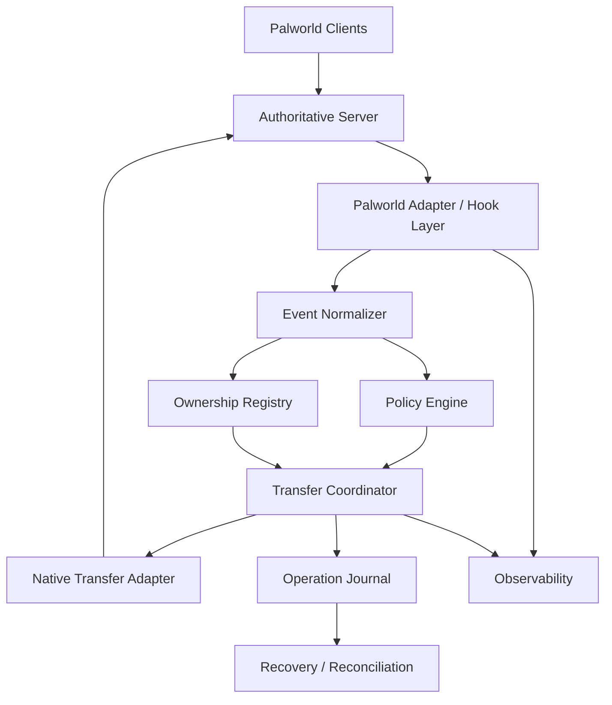

# PalHomeward — Master development, testing and validation plan

> **Project:** PalHomeward\
> **Plan version:** 1.0\
> **Preparation and source review date:** 22 November 2026\
> **Product target:** PalHomeward 0.1.0 (MVP)\
> **Operating language:** English\
> **Default policy:** `AUTO_RETURN` — automatic return to the owner\
> **Execution strategy:** implementation assisted by AI agents, with verifiable gates and reproducible evidence\
> **Status:** **PLAN / NOT IMPLEMENTED**. Inclusion in this document does not verify any removal hook, movement API or in-game test result.
>
> **Translation:** English translation of [docs/es/plan.md](es/plan.md); the English version is canonical.

---

## Table of contents

1. [Project purpose and contract](#1-project-purpose-and-contract)
2. [Evidence, assumptions and open questions](#2-evidence-assumptions-and-open-questions)
3. [Scope, user experience and requirements](#3-scope-user-experience-and-requirements)
4. [Technology decisions and environments](#4-technology-decisions-and-environments)
5. [Domain model and invariants](#5-domain-model-and-invariants)
6. [Architecture and internal contracts](#6-architecture-and-internal-contracts)
7. [Persistence, consistency, recovery and backups](#7-persistence-consistency-recovery-and-backups)
8. [Hook research and discovery protocol](#8-hook-research-and-discovery-protocol)
9. [Detailed phase plan and gate criteria](#9-detailed-phase-plan-and-gate-criteria)
10. [Unit and property test catalog](#10-unit-and-property-test-catalog)
11. [Integration, multiplayer and failure tests](#11-integration-multiplayer-and-failure-tests)
12. [Performance, compatibility and regression](#12-performance-compatibility-and-regression)
13. [Development procedure for AI agents](#13-development-procedure-for-ai-agents)
14. [CI, evidence, review and release criteria](#14-ci-evidence-review-and-release-criteria)
15. [Repository structure and initial configuration](#15-repository-structure-and-initial-configuration)
16. [First tasks for the agent](#16-first-tasks-for-the-agent)
17. [Risks, alternatives and pending decisions](#17-risks-alternatives-and-pending-decisions)
18. [References and traceability](#18-references-and-traceability)
19. [Annexes: operational templates](#19-annexes-operational-templates)

---

## 1. Project purpose and contract

### 1.1. Problem

In Palworld, members of the same guild can work on a shared base. Personal Pal storage and base worker slots may follow different ownership rules. When a player removes a Pal contributed by another guild member, the Pal may end up in the storage of the player who removed it. This can cause confusion, temporary loss of access and unwanted outcomes after a player disconnects or changes guilds.

Players have asked in community discussions for workers to go back to their original owners, regardless of who reorganized the base. See [COM-01], [COM-02], [COM-03] and [COM-04]. **Forum posts describe player experiences. Use API documentation for API details and verify the mechanic for each version.**

### 1.2. Expected outcome

Example:

1. Player **A** owns a Foxparks identified by the unique instance `pal-001`.
2. A assigns `pal-001` to a base shared with player **B**.
3. B wants to replace it and requests removal through the Palbox or another game interface.
4. PalHomeward determines that A is still the legitimate owner.
5. **If a safe native redirection mechanism exists**, the Pal goes to A's valid personal storage even though B removes it.
6. The Foxparks retains its identity and attributes, ownership stays with A, and both players can continue working together as usual.

The action should feel seamless to the player, ideally without extra dialogs, a second inventory interface or changes to worker AI.

### 1.3. Fundamental safety condition

**Never create, destroy, clone or directly rewrite a Pal as the standard way to return it.** Prefer legitimate server operations. If the engine offers no way to safely intercept or redirect the operation, keep the MVP in observation mode or validated protection mode and withhold any claim that automatic return works.

### 1.4. Priorities in order

1. Save integrity and prevention of loss or duplication.
2. Reliable identification of the owner and instance.
3. Server authority over the destination so clients cannot choose it on their own.
4. Operation with the owner offline, **if the API permits it**.
5. Compatibility with normal work and transfer flows.
6. Unobtrusive presentation and minimal configuration.
7. Performance, maintainability and adaptability to updates.

### 1.5. Definition of done

PalHomeward 0.1.0 is complete only when it meets **all** G0–G8 gate criteria in sections 9 and 14. A verified implementation requires evidence beyond this document, simulated unit tests or the presence of a `.lua` file.

---

## 2. Evidence, assumptions and open questions

### 2.1. Documented facts

| ID | Statement | Confidence | Evidence |
|---|---|---|---|
| DOC-01 | The official dedicated server mod system is documented for **Windows**. Pocketpair warns of save corruption risk. | High, based on the official documentation reviewed | [OF-01] |
| DOC-02 | The official loader supports Lua/UE4SS mods and uses an `Info.json` package file with `InstallRule`. Server mods must declare `IsServer: true`. | High | [OF-02], [OF-03] |
| DOC-03 | UE4SS provides `RegisterHook` for loaded Unreal functions. **The presence of a callback does not establish that the original function can be cancelled.** | High for the documented API | [UE-01] |
| DOC-04 | In UE4SS, the pre/post behavior of `RegisterHook` depends on the function. Additional callbacks may have different capabilities. | High | [UE-01] |
| DOC-05 | Some Palworld UE4SS projects observe objects, bases and workers. | High for those projects only | [REF-01], [REF-02] |
| DOC-06 | Save tools document fields such as `PlayerUId`, `InstanceId` and `PalStorageContainerId`. Any correspondence to a live ownership API requires verification. | High as a reference for save structure only | [SAVE-01] |
| DOC-07 | Experimental community Linux implementations exist. Official Windows support remains the target, and those implementations have yet to be validated for this mod. | High regarding the status reported by the projects | [LIN-01], [LIN-02] |

### 2.2. Unverified assumptions to investigate

- **H-01:** A server function processes worker removals and can be intercepted before it changes containers.
- **H-02:** A removal can be denied or redirected without the game subsequently performing any part of the original operation.
- **H-03:** A Pal instance retains a stable identifier across all planned storage changes.
- **H-04:** Native data is sufficient to determine the legitimate owner of Pals already assigned when the mod is installed.
- **H-05:** A personal Palbox can be accessed or used as a transfer destination while its owner is offline.
- **H-06:** Capacity, reserved slots and locked states can be checked without race conditions.
- **H-07:** All removal paths (Palbox, base menu, third-party mods and automation) go through one verifiable function or a small set of points we can cover.
- **H-08:** Legitimate ownership can be preserved in trades, breeding, dismissal, release, sales, guild changes or voluntary transfers without mistaking them for worker removal.

**Instruction for agents.** Never turn these hypotheses into implementation claims based on deduction, intuition or similar names. Record the test, build, logs and exact function or mark it `UNVERIFIED`.

### 2.3. Blocking questions for phase 0

| Question | Evidence needed | Blocks |
|---|---|---|
| Which `UFunction`/RPC receives the removal request? | Exact path, class, parameters and observed server call | G2 |
| Is the hook PRE or POST? | Trace showing call order relative to an observable container change | G2 |
| Can the removal actually be cancelled? | Denied removal with both containers unchanged | G5 |
| Can the destination be replaced natively? | Redirected removal in a disposable copy with no double execution | G6 |
| What is the Pal's stable identity? | Correlation between runtime and save data before and after | G3 |
| How can the original owner be identified? | Authoritative source and documented ambiguous cases | G3 |
| How can offline owners be handled? | Server test with A offline and B online | G6/G7 |

### 2.4. Version rule

At the start of each experimental cycle, record the following in `docs/compatibility.md`:

```text
Palworld client version:       <EXACT_VERSION>
Palworld dedicated version:    <EXACT_VERSION>
Steam build ID (server):       <EXACT_BUILD_ID>
UE4SS distribution/version:    <EXACT_TAG_OR_COMMIT>
PalHomeward git commit:           <GIT_SHA>
Operating system:             <WINDOWS_VERSION>
Package installation method:  <MANUAL|OFFICIAL_LOADER>
Test world snapshot hash:     <SHA256_OR_MANIFEST>
```

Claim compatibility only for the **exact version** and build tested. Following a game update, reopen G2–G8 according to the impact.

---

## 3. Scope, user experience and requirements

### 3.1. In scope for MVP 0.1

- One guild with at least two members and one or more shared bases.
- Persistent individual ownership of a Pal identified by its instance.
- Removal of another player's worker and return to its owner through a **verified native flow**.
- Removal of one's own worker without unexpected ownership changes.
- Safe handling of full, offline or unresolvable destinations.
- Mutual exclusion for concurrent requests on the same instance.
- Minimal operation logging, reconciliation and diagnostics.
- Observation mode and experimental protection mode for lab use.
- Documented installation on a **Windows** dedicated server.
- Clean restoration of world backups, deactivation and recovery.

### 3.2. Out of scope for MVP 0.1

- Visual Palbox filtering and a modified client.
- Hiding other members' physical Pals from players.
- A full lending, contract or trading system.
- Automatic migration of Pals with ambiguous historical ownership.
- Automatic bulk recovery when leaving a guild. The initial scope is to document the risk.
- Guaranteed support for Linux, P2P sessions or Game Pass/Microsoft Store.
- Editing saves directly while the server is running.
- Rewriting AI paths, tasks and worker behavior.
- Automatic compatibility with all third-party mods.

### 3.3. Functional requirements (RF)

| ID | Observable requirement | Priority | Minimum evidence |
|---|---|---|---|
| RF-01 | Identify a Pal by instance and distinguish Pals of the same species. | P0 | A/B test with 2 identical Pals |
| RF-02 | Resolve the owner using a verified source or reliable registry. | P0 | Source log and comparison against the game |
| RF-03 | Preserve the owner when assigning a Pal as a worker. | P0 | Owner UID before and after |
| RF-04 | Remove one's own Pal through the usual flow. | P0 | IT-02 |
| RF-05 | Remove another player's Pal and send it to its owner's storage. | P0 | IT-01 |
| RF-06 | Prevent accidental appropriation through other covered interfaces. | P0 | IT-09/IT-10 |
| RF-07 | Reject ambiguous actions or leave them incomplete without destroying data. | P0 | Unit tests + IT-11 |
| RF-08 | Handle offline owners when a supported mechanism exists. | Conditional P0 | IT-03. If impossible, **withhold the offline promise from the MVP release** |
| RF-09 | Prevent Pal duplication when two removals are concurrent or repeated. | P0 | IT-05/IT-06 |
| RF-10 | Preserve ownership after a restart. | P0 | IT-07 |
| RF-11 | Reconcile incomplete operations without blindly retrying them. | P0 | IT-08 |
| RF-12 | Operate in `OBSERVE` mode without mutating containers. | P0 | IT-00 |
| RF-13 | Keep an auditable record of decisions and errors. | P1 | Test logs |
| RF-14 | Allow PalHomeward to be disabled while preserving the native save. | P0 | IT-18 |
| RF-15 | Prevent reassignment of ownership when someone opens a UI or stands near a Pal. | P0 | Unit test for irrelevant events |
| RF-16 | Allow automated tests of pure logic without running the game. | P1 | `pytest`/Lua tests |

**Important.** The engine may make offline owners' storage inaccessible. Never silently fall back to the actor's Palbox. Adopting an alternative policy requires explicit changes to this plan and the release scope.

### 3.4. Nonfunctional requirements (RNF)

| ID | Requirement | Measurable condition |
|---|---|---|
| RNF-01 | Identity integrity | 0 duplicated or missing instances in mandatory tests |
| RNF-02 | Attribute preservation | Equivalent hash or snapshot for the Pal's logical state, with justified exclusions for volatile fields |
| RNF-03 | Authority | No mutations based solely on client-supplied ownership data |
| RNF-04 | Tolerance of changes | Disable mutations and emit a diagnostic for an unknown hook or unvalidated version |
| RNF-05 | Startup and shutdown | The mod can be disabled without manually editing the `.sav` |
| RNF-06 | Latency | Log p50/p95/p99 and compare against vanilla. Provisional release threshold is p95 overhead ≤ 10 ms per removal, measured locally in the same environment |
| RNF-07 | Logs | Keep cause, operation, failure type and correlation data. Exclude passwords, tokens and sensitive data |
| RNF-08 | Reproducibility | Document the build, version, steps and exact output of each test |
| RNF-09 | Maintainability | Separate domain logic from the Unreal adapter and cover at least 90% of ownership decision branches in tests |
| RNF-10 | Dependencies | Review versions and licenses. Do not copy code from projects with incompatible licenses |

These project performance thresholds require validation with measurements.

### 3.5. User stories and acceptance criteria

**US-01 — Natural reorganization.** As player B, I want to replace A's workers without keeping A's Pals. **Acceptance.** After replacement, `pal-001` is found only in A's correct container and retains its attributes. The replacement Pal is assigned correctly.

**US-02 — Return while offline.** As A, I want my workers to remain on the base while I am offline and be returned without my having to log in. **Acceptance.** A disconnects, B removes a worker, then A reconnects and recovers the same instance without arranging a manual transfer. This depends on G6 offline compatibility.

**US-03 — Protection by default.** As an administrator, I want cases without a reliable owner or safe destination to be denied before containers change. **Acceptance.** The Pal remains in place and the system provides a traceable message.

**US-04 — Nondestructive uninstall.** As an administrator, I want to go back to vanilla. **Acceptance.** After a clean shutdown and mod deactivation, the world loads and its Pals remain available. The game can read backups created during confirmed operations without the mod.

---

## 4. Technology decisions and environments

### 4.1. Primary approach supported by documentation

- **Server.** Palworld Dedicated Server for Windows.
- **Loader.** Official mod mechanism plus UE4SS compatible with the exact build.
- **Integration.** Lua scripts. Consider a native C++ hook only if formal research demonstrates that Lua cannot intercept a required operation.
- **Auxiliary data.** Use JSON and an operation journal only after verifying reliable writes from the runtime. Otherwise consider a controlled, documented native library.
- **Testable logic.** Pure Lua modules, with Python `pytest` as a harness for contract scenarios and reporting tools. Verify actual behavior with Lua and the server as well.
- **IDE.** VS Code/IntelliJ with Lua support. **SCM.** Git.

**Note.** The official mod loader loads code. Required transfer hooks need separate verification. [OF-02, UE-01]

### 4.2. Minimum environments

| Environment | Purpose | Allowed data |
|---|---|---|
| E0 — Offline | Pure Lua/Python tests, lint, schema and simulated scenarios | Synthetic fixtures only |
| E1 — Windows lab | Dedicated server with UE4SS and a disposable world | New saves or explicitly made copies |
| E2 — Multiplayer | E1 plus two clients with distinct accounts in the same guild | Versioned disposable world |
| E3 — Validation | Same build, freshly restored world and fixed configuration | Immutable golden snapshot |
| E4 — Experimental Linux | Investigate portability after a stable Windows MVP | Never use production saves |

Use neither the players' regular world nor the production home server for the first write tests.

### 4.3. Windows lab setup

1. Install Palworld Dedicated Server on Windows following [OF-04].
2. Start it **without mods** and confirm that two players can join and leave. Record the version and build.
3. Create and save a new world, stop the server cleanly and take a **complete snapshot** of the save and configuration directories. Include the per-player data and additional storage alongside `Level.sav`. [SAVE-01]
4. Compute a SHA-256 hash or manifest for the snapshot and store it outside the active directory.
5. Install and enable the loader and UE4SS according to [OF-01] and [UE-02]. Never assume that a legacy proxy DLL installation and a Workshop-managed installation are identical.
6. Generate the development package with the official uploader or prepare a package that strictly conforms to its format. Validate `Info.json`.
7. In `Mods/PalModSettings.ini`, enable the correct `PackageName` entries, set `bGlobalEnableMod=true` and restart. Verify actual installation and logs after copying the files. [OF-01]
8. Run a `main.lua` that only prints a startup marker. Keep mutation hooks out of this step.
9. Confirm **exactly one** startup log entry per launch. If the mod loads repeatedly, fix the configuration before proceeding.
10. Archive the `environment.json` manifest with versions, hash, installation method and log location.

The official loader uses `InstallRule` (singular), supports `Type: "Lua"` rules and uses `IsServer: true` for server installation. Use the uploader-generated file as the basis for an up-to-date example. [OF-03]

### 4.4. Deactivation and recovery path

- Stop the server cleanly and confirm that it has finished saving.
- Copy the current save and PalHomeward auxiliary data separately.
- Disable `PackageName` in `ActiveModList` and restart. The documented `-NoMods` emergency option leaves pending operations in need of reconciliation. [OF-01]
- If there are `PREPARED`/`UNCERTAIN` operations, keep the server stopped and follow the analysis protocol. Restore a consistent snapshot if appropriate. Never automatically delete Pals to repair duplicates.

### 4.5. Linux and Steam Deck for later research

- At the time of review, Pocketpair's official modded server path excluded Linux. [OF-01]
- Experimental community projects use hooks/UE4SS or alternative frameworks on Linux. Treat Linux as a **new backend** with complete parity, safety and licensing checks. [LIN-01, LIN-02]
- Steam Deck can serve as a client in later experiments. Verify separately whether it needs or supports the same mod installation. The first iteration prioritizes server-authoritative logic without additional UI.

---

## 5. Domain model and invariants

### 5.1. Terms

- **PalInstanceId:** Stable identifier of an individual creature, **verified** for the current build and independent of species or name.
- **OwnerUid:** Original or legitimate owner under explicit rules.
- **ActorUid:** Player who requested the worker move.
- **SourceContainerId:** Container or slot the Pal currently occupies.
- **DestinationContainerId:** Authorized destination container.
- **BaseId/GuildId:** Operation context. Neither is sufficient evidence of ownership.
- **NativeTransfer:** Game call or sequence that the server processes and confirms.
- **WorldId:** World identifier that scopes the registry. Identical numeric instance IDs in different worlds must remain distinct.
- **OperationId:** Unique correlation and idempotency token generated by PalHomeward.

These names define **internal contracts**. Exact Unreal member names require separate evidence.

### 5.2. Invariants (INV)

| ID | Invariant | How to verify |
|---|---|---|
| INV-01 | A Pal instance has **one** authoritative state or location at a time within the covered scope. | Count references and query the runtime |
| INV-02 | Worker removal preserves `OwnerUid`. | Before-and-after comparison |
| INV-03 | An ambiguous request never defaults to `ActorUid` as owner. | Tests for unknowns and failures |
| INV-04 | The same `OperationId` request never executes two moves. | Duplication and retry tests |
| INV-05 | The actor cannot specify an arbitrary owner to force a transfer. | Malicious actor or modified client test |
| INV-06 | A move can be confirmed only with current validation of source and destination. | Test with changed state |
| INV-07 | `CONFIRMED` requires checking the game state beyond receiving an “OK.” | False response test |
| INV-08 | A discrepancy between registry and game is marked `RECONCILIATION_REQUIRED`. | Crash test |
| INV-09 | Disabling the mod leaves the world independent of fictional containers. | Uninstall test |
| INV-10 | Product decisions require evidence for any hook they rely on. | Audit `hook-catalog.md` |

**INV-01 clarification.** Auxiliary references, indexes and serialization representations can exist. The same instance must never have **two active playable locations** in the same world state.

### 5.3. Source of ownership

1. Prefer an explicit, stable native source **only after demonstrating that it represents ownership and distinguishes the owner from the last player to move the Pal**.
2. For Pals assigned after enabling the mod, record ownership at an event whose semantics have been cross-checked.
3. Pals already on bases at installation may have ambiguous ownership. **Never infer it from slot order, name or proximity.**
4. For ambiguous records, set `UNRESOLVED`, keep `AUTO_RETURN` disabled for that Pal and provide safe manual migration guidance.
5. Voluntary transfers between players follow **a separate flow**. In the MVP, leave that flow unintercepted if it cannot be identified reliably. Preserve ownership changes from legitimate transfers.
6. Never accept a client UUID as proof of identity without server-side corroboration.

### 5.4. Logical transitions

```text
WORKING(owner=A, base=X)
    -- B requests removal --> VALIDATING
    -- source, destination, owner OK --> RESERVED
    -- native operation confirmed --> IN_OWNER_STORAGE(owner=A)
    -- error before mutation --> WORKING(owner=A, base=X)
    -- state cannot be verified --> RECONCILIATION_REQUIRED

If A removes their own Pal, normal destination = A's storage.
```

The **transient states** `VALIDATING` and `RESERVED` are internal to PalHomeward and leave engine states intact. The first version must return creatures without a fictional virtual container.

### 5.5. Destination validation policy

Before authorizing a move, verify all of the following:

- A compatible `WorldId` exists and the instance belongs to that world.
- The Pal is actually in an authorized worker slot and matches the request.
- Ownership has been validated and there is no version or revision conflict.
- The destination is **the owner's correct personal container**. A visible Palbox alone is insufficient.
- The destination accepts the Pal, has actual space and is free of locks from other operations.
- The actor has permission to reorganize the base under the game's rules.
- The request is consistent with current state and concurrent operations.

If any check is unavailable, prohibit speculative moves. If the hook cannot cancel before mutation, **keep the mod in observation mode** and withhold any promise of protection.

---

## 6. Architecture and internal contracts

### 6.1. Component view



### 6.2. Separation of responsibilities

| Component | Input | Output | Constraint |
|---|---|---|---|
| `main.lua` | UE4SS startup | Module and hook registration | No business logic |
| `probe.lua` | Runtime signals | Structured logs | Read-only |
| `palworld_adapter.lua` | `UObject`, RPC, parameters | Normalized events | Contains all engine calls |
| `ownership.lua` | Verified instance data | Owner or `UNRESOLVED` | No access to Unreal objects |
| `policy.lua` | Request, owner, permissions, destination | `ALLOW`, `REDIRECT`, `DENY` | Deterministic and testable |
| `transfer.lua` | Authorized decision | Transactional state | Prevents duplicate operations |
| `journal.lua` | Operation event | Durable, validated record | Never assume `fsync` exists |
| `reconcile.lua` | Journal and runtime snapshot | Confirmed, pending or anomalous | Never correct data blindly |
| `compatibility.lua` | Versions and capabilities | Safe mode | Mutations disabled without evidence |
| `logging.lua` | Events and error codes | JSONL/console | Excludes secrets |

### 6.3. Domain API: normative pseudocode

> **Non-executable pseudocode.** The `native.*` methods are adapter interfaces to be implemented. Never present them as real Palworld functions.

```text
handleWorkerRemoval(request):
  require serverAuthority() == true
  require capability("PRE_MUTATION_INTERCEPTION") == VERIFIED
  require capability("CANCEL_OR_REDIRECT") == VERIFIED

  request = normalizeAndValidate(request)
  assert request.worldId == currentWorldId

  with perPalLock(request.palInstanceId):
    if journal.hasCompleted(request.operationId):
      return journal.previousResult(request.operationId)

    state = native.readFreshState(request.palInstanceId)
    if not state.isWorkerIn(request.baseId, request.sourceSlot):
      return DENY("SOURCE_CHANGED")

    owner = ownership.resolveVerifiedOwner(state, registry)
    if owner is UNRESOLVED:
      return DENY("UNKNOWN_OWNER")

    assert actorMayManageWorkers(request.actorUid, request.baseId)
    destination = native.resolveOwnerPersonalStorage(owner)

    if not native.canSafelyAccept(destination, state):
      return DENY("DESTINATION_NOT_AVAILABLE")

    journal.recordPrepared(request, owner, source, destination)
    outcome = native.executeVerifiedMoveOnce(state, destination)

    finalState = native.readFreshState(request.palInstanceId)
    if outcome and finalState.isOnlyAt(destination):
      journal.recordConfirmed(...)
      return SUCCESS

    journal.recordUncertain(...)
    return STOP_AND_RECONCILE
```

### 6.4. Hook rules

`RegisterHook` takes a `UFunction` path and callbacks. The documentation distinguishes PRE from POST and separates replacement of the *return value* from cancellation of the original function body. **A hook's return value does not prove that a transfer was cancelled.** Never make `return false` mean “cancel” in code without in-game evidence. [UE-01]

- Register once, check that the function already exists and release hooks where appropriate.
- Normalize `UObject` and `RemoteUnrealParam` references to simple data. Never retain references beyond their verified lifetime.
- Access engine objects on the correct thread according to the API and measured behavior. Keep blocking disk I/O out of critical callbacks.
- Prevent reentrant loops. A return initiated by PalHomeward may trigger movement hooks again.
- Isolate actual names and paths in the adapter for revalidation after updates.

### 6.5. Result codes

```text
OK_RETURNED_TO_OWNER
OK_OWNER_SELF_REMOVAL
DENY_UNKNOWN_PAL
DENY_UNKNOWN_OWNER
DENY_UNAUTHORIZED_ACTOR
DENY_SOURCE_CHANGED
DENY_OWNER_STORAGE_UNAVAILABLE
DENY_DESTINATION_FULL
DENY_CONCURRENT_OPERATION
DENY_UNSUPPORTED_TRANSFER_PATH
ERROR_HOOK_NOT_VERIFIED
ERROR_NATIVE_TRANSFER_FAILED
ERROR_PERSISTENCE_FAILED
ERROR_RECONCILIATION_REQUIRED
ERROR_GAME_BUILD_UNSUPPORTED
```

Every response includes `operationId`, `worldId`, `palInstanceId`, a code and a decision. The IDs can be pseudonymized in logs. Use the server's final state to prove movement. A message alone is insufficient.

---

## 7. Persistence, consistency, recovery and backups

### 7.1. Location and scope

Keep writable PalHomeward data out of the packaged scripts' source directory because Workshop updates may overwrite it. Choose a separate data path and **document and verify** its permissions and how it survives updates. The abstract path is `<SERVER_WRITABLE_DATA>/PalHomeward/<WorldId>/`.

Proposed layout:

```text
PalHomewardData/<WorldId>/
  ownership.v1.json
  transfer-journal.v1.jsonl
  compatibility.json
  diagnostics/
  checkpoints/
```

**Never assume** Lua has safe, atomic or durable filesystem access. Validate `io`, `os.rename`, permissions and flush operations. If a reliable journal cannot be guaranteed, choose a tested native dependency or reduce the MVP to safe mode.

### 7.2. Proposed registry model

```json
{
  "schemaVersion": 1,
  "worldId": "WORLD_ID_FROM_RUNTIME",
  "gameBuild": "VERIFIED_GAME_BUILD",
  "revision": 17,
  "pals": {
    "PAL_INSTANCE_ID": {
      "ownerUid": "PLAYER_A_UID",
      "ownerEvidence": "verified_native_source",
      "ownerEvidenceRevision": 3,
      "status": "VERIFIED",
      "lastKnownBaseId": "BASE_ID",
      "lastKnownContainerId": "BASE_WORK_SLOT_CONTAINER",
      "lastSeenOperationId": "OP_ID"
    }
  }
}
```

These fields represent the **PalHomeward** schema. The original save uses its own format. Refresh state from the server before trusting `lastKnownContainerId`.

### 7.3. Transfer journal

Valid states:

```text
NEW -> PREPARED -> EXECUTING -> CONFIRMED
                   |       |
                   +-------+--> RECONCILIATION_REQUIRED
```

- `PREPARED` records the validated decision and operation before invoking a mutation.
- `EXECUTING` indicates that the operation has started. **Success remains unconfirmed.**
- `CONFIRMED` records a cross-checked and stable final server state.
- `RECONCILIATION_REQUIRED` indicates a failure, crash, discrepancy or incomplete confirmation.

**Structural limitation.** No shared ACID transaction spans `Level.sav`, player data, mod data and the JSON journal. The design aims for *at-most-once execution* per request during runtime and reconciliation against actual state after a restart. Exactly-once execution after a crash is not guaranteed. Never blindly replay a `PREPARED` row.

### 7.4. Recovery policy

1. Start up, read the version and check auxiliary data integrity.
2. Detect unconfirmed operations and temporarily disable mutations for the affected instances.
3. Query actual containers and locate each affected instance.
4. Classify each instance:
   - **A:** It is exactly at the destination. Mark `CONFIRMED_RECOVERED`.
   - **B:** It is exactly at the source and unchanged. Mark `ABORTED_SAFE` once you confirm that no other operation is active.
   - **C:** It is missing, duplicated or inconsistent. Mark `MANUAL_REVIEW_REQUIRED` and leave all instances in place.
5. Save diagnostics and restore the configured mode when safe.
6. Retain the log and checksum for auditing.

### 7.5. Backups and restoration

- Take a **consistent cold backup**. Stop the server, confirm shutdown and copy the entire world and PalHomeward data. Record hash, build and date.
- Use **test worlds only** for failures mid-move. A copy taken mid-write may be inconsistent.
- Before each write experiment, make a new snapshot or restore a clean one.
- Practice an **actual restore** after creating the backup.
- Retain a lab snapshot from before the first mod and another from before the AutoReturn experiment.
- Keep real saves out of public repositories. Fixtures must be synthetic or explicitly anonymized.

### 7.6. Schema and migrations

- Increment `schemaVersion` for every schema version and include a nondestructive read and migration routine.
- For a future or unknown schema, operate only in `OBSERVE` and report an error.
- Write `ownership.v1.json` only after it passes full validation.
- Test truncated JSON, duplicate entries, incompatible world ID, UTF-8 corruption and revision conflicts.
- A mod update must **never** infer new owners because a field is missing.

---

## 8. Hook research and discovery protocol

### 8.1. Probe objective

Build `PalHomewardProbe` as a **100% observational** mode. It logs worker and container activity without moving Pals, changing ownership or attempting to cancel calls. It produces reproducible evidence for building the adapter later.

### 8.2. Sources of leads, without API guarantees

- `EnhancedBaseLogistics` demonstrates UE4SS Lua on a dedicated server with access to base models and events. It focuses on logistics. [REF-01]
- `TidyBaseInfo-PUBLIC` includes a “Send to Palbox” action that uses server requests and can help locate flows. **A client UI does not prove that the server operation can be blocked.** [REF-02]
- Hook API, registration conditions, parameters and execution on the game thread. [UE-01], [UE-03]
- Identity cross-check for correlating observations with save state. [SAVE-01]

**Licenses.** Inspect the reference repository's `LICENSE` and the license of each relevant file before reusing code. If the license is restrictive, use it only for conceptual research and write original code.

### 8.3. Discovery method

1. Confirm that the mod loads and that the process is the dedicated server. Rule out an accidental client launch.
2. Create two test identities, A and B, in the same guild, with one base and two Pals of the same species to test IDs.
3. Find and record candidate paths and classes through object inspection, reflection and reference sources, along with the **exact build**.
4. For each candidate, verify existence and call order relative to the move. Record whether it is PRE or POST and whether it runs in the server context.
5. Log primitive values: `WorldId`, `PalInstanceId`, `ActorUid`, `BaseId`, `SourceContainerId`, requested destination, time and thread context when verifiable.
6. Repeat assignment, own-worker removal, another player's worker removal, two-worker swaps, UI closure without moving a worker, and removal with the owner offline.
7. Correlate logs with observed Palbox changes before and after. An event without an inventory change does not confirm a removal.
8. Discover alternative entry points such as the Palbox menu, quick menus, mods such as TidyBaseInfo and automated operations. Record coverage and verify which RPCs each path uses.
9. Create `docs/hook-catalog.md` with one card per candidate function.
10. Propose a cancellation experiment **only** once there is sufficient evidence and a disposable snapshot.

### 8.4. Hook card template

```yaml
hook_id: H-001
path: "<REAL_UFUNCTION_PATH_FROM_REFLECTION>"
engine_class: "<CLASS>"
game_build: "<EXACT_BUILD>"
ue4ss_version: "<TAG>"
observed_in: "dedicated-server-windows"
callback_phase: "PRE|POST|UNKNOWN"
request_actor_source: "<VERIFIED_PATH_OR_UNKNOWN>"
pal_instance_source: "<VERIFIED_PATH_OR_UNKNOWN>"
source_container_source: "<VERIFIED_PATH_OR_UNKNOWN>"
requested_destination_source: "<VERIFIED_PATH_OR_UNKNOWN>"
can_cancel_original: "UNTESTED|YES|NO"
can_change_destination: "UNTESTED|YES|NO"
source_code_reference: "<FILE_AND_LINE_OR_NA>"
experiment_log: "<ARTIFACT_PATH>"
reproduction_steps: "<DOC_SECTION>"
confidence: "OBSERVED|CROSS_CHECKED|VERIFIED"
```

### 8.5. Critical distinction between observation, cancellation and redirection

Each capability requires separate evidence:

- **Observation.** The callback receives data when an action occurs.
- **Cancellation.** The server skips the original transfer and both containers retain their state.
- **Redirection.** The server processes the action exactly once with the owner's storage as destination and skips the original move.

Publishing `AutoReturn` requires proof of both cancellation and redirection. A **POST** return (moving B→A after the game moves base→B) introduces windows for appropriation, loss, capacity problems, races and crashes. **The 0.1 design prohibits it.**

### 8.6. If no suitable hook exists

Follow one of these decision branches:

- **Option A.** Locate another native `UFunction`/RPC with interception capability.
- **Option B.** Prototype a native C++ detour with signature, threading and crash safety validation. This requires an ADR, risk review and a new test matrix.
- **Option C.** Explicitly change scope to `OBSERVE` or to protection **only if cancellation is confirmed**. Never misrepresent functionality.

AI agents must never edit live `.sav` files or clone objects as a shortcut.

---

## 9. Detailed phase plan and gate criteria

### Gate overview

| Gate | Deliverable | What it demonstrates | Passing criteria |
|---|---|---|---|
| G0 | Repository and protocol | Environment and test discipline | Sources, scripts, licenses, version and `README` |
| G1 | Loader and basic probe | Lua runs on the dedicated server | Log signed for the build, one load and no mutations |
| G2 | Observed hook | Actual removals are identified | 10/10 correlated cases with correct actor and instance |
| G3 | Stable ownership | Correct owner and Pal | A/B, repeated, restart and ambiguous cases without false attributions |
| G4 | Pure core and journal | Robust, testable policy | All critical unit tests and fault simulations PASS |
| G5 | Safe cancellation | Removal can be blocked | 20/20 denial trials with native state intact |
| G6 | Native AutoReturn | Correct actual redirection | 30/30 across cross-owner, own-owner, offline and capacity cases in the matrix |
| G7 | Concurrency and recovery | No duplicates under failure | Crash matrix, 100 controlled requests or retries, restoration PASS |
| G8 | Release candidate | Compatibility and uninstall | Complete matrix, soak test, packaging, review and documentation |

These counts are acceptance targets for the lab. Results require actual evidence.

### Phase F0 — Prepare the repository, operating rules and infrastructure (G0)

**Tasks**

- [ ] Create a Git repository with `README.md`, the chosen `LICENSE`, `.gitignore` and this plan.
- [ ] Include `AGENTS.md` (summary derived from section 13), `docs/decisions/`, `docs/evidence/`, `docs/compatibility.md` and `docs/hook-catalog.md`.
- [ ] Define branches, commit conventions and rules for small PRs.
- [ ] Add baseline `pytest` tests, Lua syntax checking and JSON validation.
- [ ] Document official Windows installation and the exact backup location from the actual lab.
- [ ] Record tool and dependency versions and check third-party licenses.
- [ ] Create synthetic fixtures and a snapshot/hash tool.
- [ ] Prepare the agent report template.

**Output.** Commit `chore: bootstrap PalHomeward`, `docs/evidence/G0/` and CI that runs without Palworld.

**G0 PASS if** the structure and licenses are present, sample tests pass, a local executable is verifiable and the documentation contains no invented APIs. **G0 FAIL if** real saves or dependencies without provenance are included, or `pytest` cannot be reproduced.

### Phase F1 — Dedicated server and safe Hello World (G1)

**Tasks**

- [ ] Create a test world, two users and a guild.
- [ ] Launch a vanilla Windows dedicated server and keep the snapshot hash.
- [ ] Install the official loader and UE4SS in versions compatible with the build.
- [ ] Load `Scripts/main.lua` containing only `print("[PalHomeward] LOADED: OBSERVE")`.
- [ ] Verify `Info.json` and `InstallRule` for the server.
- [ ] Confirm that the script is active on the server itself.
- [ ] Restart 3 times and check for **one** initialization per restart.
- [ ] Run `-NoMods` and demonstrate that the world opens again without PalHomeward.

**Evidence.** `logs/startup-01..03`, build manifest, screenshots of the directory structure and hashes before and after a cycle without mutation.

**G1 PASS if** 3/3 startups are correct, 0 UE4SS exceptions are attributable to the mod, there are 0 game state writes, and restoration is demonstrated. **Blocker.** If UE4SS fails to load, stop before analyzing Pals.

### Phase F2 — Discover removal and runtime data (G2)

**Tasks**

- [ ] Research [REF-01] and [REF-02] and document concrete findings (file, function, path and build).
- [ ] Implement `probe.lua`. Allow activation without a restart only if the runtime supports it under test. Otherwise restart.
- [ ] Log assignment and removal events and never invoke moves.
- [ ] Capture and compare data from 10 removals: 4 own-worker removals, 4 other-owner removals and 2 quick replacements.
- [ ] Repeat with two identical Pals to detect collisions by species or name.
- [ ] Confirm that `ActorUid` identifies the actual initiator. Rule out a spectator or the owner of the controller.
- [ ] Identify the actual PRE/POST phase.
- [ ] Complete `hook-catalog.md` and flag unobservable methods and alternative points.

**Evidence.** `docs/evidence/G2/events.jsonl`, correlation table, screenshots or recordings for 10 cases, and snapshot hashes.

**G2 PASS if** 10/10 cases correlate with the correct actor and instance, opening and closing the interface causes no false detections, and the exact path and phase are verified. **G2 FAIL if** identity is inferred from names or fictional paths are used.

### Phase F3 — Ownership and conservative migration (G3)

**Tasks**

- [ ] Research and cross-check the meaning of any `OwnerPlayerUId` or equivalent runtime or save field.
- [ ] Define the algorithm with confidence levels `VERIFIED`, `UNRESOLVED` and `CONFLICT`.
- [ ] Record the owner when a Pal is assigned and an authoritative source is available.
- [ ] Confirm stability across assignment, own-worker removal, restart and base changes.
- [ ] Design **non-automatic** migration for existing Pals with ambiguous owners.
- [ ] Prevent the removal actor from overwriting the owner.
- [ ] Create tests for two owners, identical Pals, missing ID, missing owner and changed world.

**Evidence.** `docs/evidence/G3/ownership-cases.csv`, fixtures, correlated logs and an explanation of the source of truth.

**G3 PASS if** the matrix contains 0 incorrect attributions, owners are stable after 3 restarts and unknown owners retain `UNRESOLVED`. **G3 FAIL if** the last player to touch a Pal is interpreted as its owner without validation.

### Phase F4 — Core policy, journal and pure tests (G4)

**Tasks**

- [ ] Implement `ownership.lua`, `policy.lua` and `transfer.lua` with an injectable fake adapter interface.
- [ ] Implement strict data, world ID and revision validation.
- [ ] Prepare `journal.lua` with verified safe writes or a justified alternative.
- [ ] Add per-instance locks, `OperationId` deduplication and reentry suppression.
- [ ] Simulate full destinations, write errors, timeouts, cancellations and ambiguous results.
- [ ] Run the same normative case set in actual Lua and in the Python harness if both exist.
- [ ] Test migrations and corruption with fixture files.

**Evidence.** `pytest` report, Lua test report, coverage and contract JSON/schema.

**G4 PASS if** 100% of P0 unit cases pass, there are 0 Unreal accesses from pure modules, 0 journal commits without confirmation, and fault tests are complete. **G4 FAIL if** Python tests a separate reimplementation while production Lua goes untested.

### Phase F5 — Verified protection and cancellation (G5)

**Prerequisite.** G2 and G3 PASS. Use a restored disposable world.

**Tasks**

- [ ] Investigate whether the hook point allows cancellation **before** mutation.
- [ ] Begin with an experimental rule that denies a controlled case, such as an owner deliberately marked `UNRESOLVED`.
- [ ] Demonstrate that the game skips the operation after the callback.
- [ ] Repeat 20 denials from the standard UI and compare native state before and after each.
- [ ] Verify the absence of side effects by checking worker stability, UI consistency and absence of ghost Pals.
- [ ] Test reentry and callback error.

**Evidence.** Before-and-after manifests for each test, the exact hook, and proof of cancellation.

**G5 PASS if** 20/20 requests are denied without movement or crash. **G5 BLOCKED if** the hook is POST-only or cannot cancel. Open a C++ ADR or limit functionality. **Executing `return false` alone never justifies a PASS.**

### Phase F6 — Native automatic return (G6)

**Prerequisite.** G5 PASS and **redirection** verified in isolation.

**Tasks**

- [ ] Identify how to resolve A's personal Palbox with A online and offline.
- [ ] Implement destination selection and fresh space and slot checks.
- [ ] Try redirection with a disposable Pal and observe **exactly one** move.
- [ ] Prevent the original transfer to actor B and demonstrate that it does not continue through another route.
- [ ] Validate identity, owner and attributes with before-and-after game state snapshots.
- [ ] Test own-worker removal, another player's worker removal, replacement, same-species Pals and an offline owner.
- [ ] Deny safely when the destination is full, resolution fails or the actor lacks authority.
- [ ] Complete voluntary transfer protocols to prevent interference with those transfers.

**Evidence.** `docs/evidence/G6/` with 30 operations and hashes or identifiers, including offline evidence.

**G6 PASS if** all 30/30 selected cases pass, there are 0 appropriations and 0 duplicates, and every `OwnerUid` remains intact. **If offline is impossible,** withhold the offline claim, leave the gate incomplete and propose an ADR and reduced-scope release for explicit approval.

### Phase F7 — Repetition, concurrency and abrupt failures (G7)

**Tasks**

- [ ] Send duplicate requests with exactly the same `OperationId`.
- [ ] Simulate two actors removing the same instance almost simultaneously.
- [ ] Test interruptions before journaling, after PREPARED, during transfer and after transfer but before `CONFIRMED`.
- [ ] For interruptions the GUI cannot reproduce, use fault injection with a fake adapter and label it a simulation. Supplement with real abrupt-shutdown tests only in disposable worlds.
- [ ] Restore and reconcile without blind replay.
- [ ] Compare instance counts and attributes for all test Pals.
- [ ] Verify that the system can disable an instance in `MANUAL_REVIEW_REQUIRED` without blocking healthy instances.

**Evidence.** `docs/evidence/G7/`, matrices by failure point, results of 100 controlled requests or retries, and crash recovery results.

**G7 PASS if** there are 0 duplicates or losses, 100/100 attempts preserve the invariants, all uncertain cases enter reconciliation, and 100% of planned restores work. **G7 FAIL if** even one operation can be retried twice after a crash without validation.

### Phase F8 — Compatibility, acceptance and packaging (G8)

**Tasks**

- [ ] Install the package using the official loader without relying on assumed development paths.
- [ ] Verify `Info.json`, `PackageName`, `Version`, `InstallRule`, `IsServer` and dependencies.
- [ ] Play a 60-minute session with 2 players and ≥ 10 workers split between 2 owners.
- [ ] Run the mandatory tests in section 11, including a restart and uninstall cycle.
- [ ] Review logs for errors, collisions, game warnings and regressions.
- [ ] Compare removal latency against the vanilla baseline.
- [ ] Document known and unsupported functionality, the recovery procedure and the exact version.
- [ ] Sign the release checklist and tag Git `v0.1.0-rc1`. Wait for approval before tagging `v0.1.0`.

**G8 PASS if** the full suite passes, 60 minutes complete without P0 incidents or major regressions, uninstall is safe, and a human explicitly reviews the test report. **G8 BLOCKED if** any mandatory case is `NOT_RUN`.

---

## 10. Unit and property test catalog

### 10.1. Tools and general criteria

- Test pure decisions **in Lua** using an interpreter whose version and semantics are compatible with UE4SS. `pytest` may orchestrate cases or verify auxiliary tools. Test the production code itself in Lua.
- Avoid mocks that assume more favorable behavior than the engine. Keep `FakePalworldAdapter` separate from actual integration tests.
- Identify `ARRANGE`, `ACT`, `ASSERT` and the covered invariant in each test.
- For randomized inputs, specify a seed, ensure reproducibility and run at least 1,000 sequences in state tests if CI time permits.
- A `PASS` requires the output from running the test and the tested commit. Writing a test alone is insufficient.

### 10.2. Unit case matrix

| ID | Case | Expected | Invariants |
|---|---|---|---|
| UT-001 | Owner A, actor B | Destination A, REDIRECT decision | INV-02 |
| UT-002 | Owner A, actor A | Destination A, normal move | INV-02 |
| UT-003 | Pal does not exist | DENY_UNKNOWN_PAL | INV-03 |
| UT-004 | Pal has no owner | DENY_UNKNOWN_OWNER | INV-03 |
| UT-005 | Conflicting owner across sources | CONFLICT/DENY | INV-03 |
| UT-006 | Pal belongs to another world | DENY | INV-06 |
| UT-007 | Two Pals of the same species | Distinguished by instance | INV-01 |
| UT-008 | Same `InstanceId` in different worlds | Keys scoped by world | INV-01 |
| UT-009 | Actor differs from owner | Actor never changes owner | INV-02 |
| UT-010 | Apparent name or species change | Display name does not change owner | INV-02 |
| UT-011 | Owner disconnects | Registry preserves owner | INV-02 |
| UT-012 | Empty OwnerUid | DENY | INV-03 |
| UT-013 | Destination box missing | DENY | INV-06 |
| UT-014 | Destination has no space | DENY_DESTINATION_FULL | INV-06 |
| UT-015 | Actor lacks permission | DENY_UNAUTHORIZED_ACTOR | INV-05 |
| UT-016 | Source slot has changed | DENY_SOURCE_CHANGED | INV-06 |
| UT-017 | Pal is no longer a worker | DENY_SOURCE_CHANGED | INV-06 |
| UT-018 | Destination changes after validation | Deny or revalidate without moving blindly | INV-06 |
| UT-019 | Repeated confirmed `OperationId` | Return previous result without mutation | INV-04 |
| UT-020 | Repeated pending `OperationId` | Block or wait without duplicating | INV-04 |
| UT-021 | Different operations on the same Pal | Serialize by instance | INV-04 |
| UT-022 | Two different Pals | Independent locks | INV-04 |
| UT-023 | Reentry into the mod's own hook | No additional move | INV-04 |
| UT-024 | Success reported without final state | No confirmation | INV-07 |
| UT-025 | Final state only at destination | Confirm | INV-07 |
| UT-026 | Appears at source and destination | Reconcile without deleting | INV-01/08 |
| UT-027 | Appears in no container | Reconcile without recreating | INV-01/08 |
| UT-028 | Truncated journal | OBSERVE/ERROR, no move | INV-08 |
| UT-029 | Invalid JSON | Safe mode without overwriting | INV-08 |
| UT-030 | Unknown future schema | Safe read-only mode | INV-08 |
| UT-031 | WorldId differs from registry | Do not load another world's ownership | INV-03 |
| UT-032 | Stale revision | Reject update | INV-06 |
| UT-033 | Journal write error | Call movement only if prepared | INV-08 |
| UT-034 | Engine callback error | Uncertain operation and diagnostics | INV-08 |
| UT-035 | Timeout | Avoid assuming failure or blindly retrying | INV-08 |
| UT-036 | Prior `CONFIRMED` and restart | No repeat transfer | INV-04/08 |
| UT-037 | `PREPARED` and Pal at source | ABORTED_SAFE after verification | INV-08 |
| UT-038 | `PREPARED` and Pal at destination | CONFIRMED_RECOVERED | INV-08 |
| UT-039 | Pal cannot be located after crash | MANUAL_REVIEW_REQUIRED | INV-08 |
| UT-040 | Unverified hook | OBSERVE mode | INV-10 |
| UT-041 | Unsupported game build | Disable mutations | INV-10 |
| UT-042 | Invalid configuration | Safe value or refusal to start in a mode that mutates state | INV-10 |
| UT-043 | Actor tries to force `ownerUid=B` | Ignore input and resolve on server | INV-05 |
| UT-044 | No-op: open or close Palbox | No move | INV-01 |
| UT-045 | No-op: inspect Pal | No change to ownership | INV-02 |
| UT-046 | External voluntary transfer | Do not intercept as worker removal | INV-02 |
| UT-047 | Slot reindexing without instance changes | Preserve ownership | INV-02 |
| UT-048 | Migration of earlier registry | Preserve verified owner | INV-02/08 |
| UT-049 | Registry duplicates | Mark conflict | INV-03/08 |
| UT-050 | Empty Pal list | No-op without crashing | INV-01 |

### 10.3. Property-based tests

Generate randomized sequences against a simplified model:

```text
Operations:
  assign(A, palX, base1)
  remove(B, palX)
  disconnect(A)
  reconnect(A)
  fillOwnerStorage(A)
  retry(operationId)
  crash(point)
  restart()
```

Require `INV-01`, `INV-02`, `INV-03`, `INV-04`, `INV-07` and `INV-08` for every sequence the model accepts. Use the explicitly documented state model as the oracle. Comparing production with an identical copy of its algorithm cannot independently prove correctness.

### 10.4. Persistence tests

- Zero-byte files, files truncated mid-line, corrupt files, files without permissions and write collisions.
- Two successive revisions, restart, version changes and a different world ID.
- Journal replay with an unconfirmed `PREPARED` record.
- Verify that recovery writes preserve the last healthy copy.
- Exclude secrets and private local paths from shareable reports.

---

## 11. Integration, multiplayer and failure tests

### 11.1. Reproducible common setup

1. Restore the golden snapshot in E2/E3.
2. Start the dedicated server and verify the game build and mod build in the logs.
3. Connect A and B, create or confirm their shared guild and record pseudonymized IDs.
4. Prepare 4–6 test Pals with distinct instances, including at least 2 of the same species. Record key attributes and owner.
5. Capture base, personal Palbox and journal state before each test.
6. Follow the case steps **exactly**. Avoid extra manual actions that change ownership.
7. Save and verify the final state in the game and, where applicable, with an **offline** read-only inspector.
8. Record `PASS|FAIL|BLOCKED|NOT_RUN` with artifacts, commit and build.
9. Restore the snapshot between destructive cases or whenever a case needs a clean start.

### 11.2. Mandatory integration cases

| ID | Essential steps | Passing criterion |
|---|---|---|
| IT-00 | Server in `OBSERVE`, 10 normal actions | 10 correlated events, 0 PalHomeward mutations |
| IT-01 | A assigns Pal X and B removes it | X appears only in A's Palbox with the same ID and attributes |
| IT-02 | A removes their own X | Same outcome as vanilla for A |
| IT-03 | A is offline and B removes X | X is in A's storage, visible on reconnect, with 0 duplicates |
| IT-04 | A's Palbox is full and B tries to remove X | X remains in place and the error is clear |
| IT-05 | A and B remove X almost simultaneously | Only one effective native operation |
| IT-06 | Repeat the same request 20 times | One confirmed move |
| IT-07 | Save and restart 3 times | Owner and instance are preserved |
| IT-08 | Crash with an uncertain operation in a test world | Reconciliation without automatic retry or duplication |
| IT-09 | B uses the standard Palbox menu | AutoReturn applies |
| IT-10 | B uses another known removal interface | AutoReturn applies if the flow is supported. Otherwise label the limitation and block release according to risk |
| IT-11 | Pal with unresolved owner | No appropriation or container change |
| IT-12 | Two Pals with matching species/name | Each remains distinguishable and retains its ID |
| IT-13 | B replaces X with Y in the same operation | X returns to A, Y occupies the intended slot, zero ghost Pals |
| IT-14 | Two bases in the same guild | Correct return from both bases |
| IT-15 | Actor lacks base permissions | Game permission rules are respected |
| IT-16 | Open and close the UI without a change | No move or ownership change |
| IT-17 | Capture a new Pal and assign it | Reliable and persistent new owner |
| IT-18 | Disable PalHomeward after a clean shutdown | World loads in vanilla and all Pals remain present |
| IT-19 | Mod has no journal or has corrupt JSON | No mutation, error and guided recovery |
| IT-20 | Apparent `InstanceId` change or unexpected state | Safe mode without moving the wrong creature |
| IT-21 | B removes X while A reconnects | No double return or race |
| IT-22 | Actor cancels the move in the interface | No false move confirmation |
| IT-23 | A's Palbox has exactly one slot available | One move and correct final capacity |
| IT-24 | Voluntary transfer through a game mechanic | Preserve the legitimate transfer and avoid mistaking it for worker removal |
| IT-25 | Restart the server without operating PalHomeward | Owners stay unchanged and nothing moves |

**Important notes**

- In IT-10, if a third-party path can bypass ownership protection, disclose the limitation in the release and assess whether it constitutes a P0 failure.
- IT-03 is mandatory for the original seamless behavior. If it cannot pass, make an explicit product decision before release.
- Never run crash tests on the real world save.

### 11.3. Fault injection table

| Point | How to simulate | Allowed result | Prohibited result |
|---|---|---|---|
| Before PREPARED | Fake adapter fails validation | Denial without movement | Partial movement |
| Writing PREPARED | Simulated disk failure | No movement | Mutation without a prepared journal |
| After PREPARED, before native move | Test crash | Pal at source, then reconcile | Blind transfer on restart |
| During native move | Abrupt shutdown in a disposable world | Uncertain state and review | Clone a Pal to compensate |
| After move, before CONFIRMED | Confirmation failure | Detect Pal at destination and reconcile | Repeat transfer |
| After CONFIRMED | Duplicate callback | Idempotent return | Second move |
| Owner disconnects during operation | Synchronized disconnect | Valid final state or safe cancellation | Reroute to actor's Palbox |
| Game update | Unvalidated build | OBSERVE/read-only | Continue executing old paths without verification |

### 11.4. Evidence format per test

```text
Test ID: IT-01
Date/time UTC: <ISO8601>
Game build: <BUILD>
UE4SS: <VERSION>
PalHomeward commit: <GIT_SHA>
World snapshot hash: <SHA256>
Actor: B
Owner: A
PalInstanceId: <ID>
Original location: base-slot-<N>
Expected location: owner-box-slot-<N>
Observed final location: <VALUE>
Owner before/after: <A>/<A>
Pal attribute fingerprint before/after: <HASH>/<HASH>
OperationId: <ID>
Logs: <PATH>
Capture: <PATH_OR_NONE>
Result: PASS|FAIL|BLOCKED|NOT_RUN
Notes: <OBSERVATIONS>
```

Never fabricate evidence. If an agent cannot launch Palworld, mark `BLOCKED` or `NOT_RUN` and provide steps for a human operator to run.

---

## 12. Performance, compatibility and regression

### 12.1. Performance

Instrument using **available and validated** monotonic timing:

- Callback or hook time (p50, p95, p99).
- Owner resolution time.
- Destination validation time.
- Native move time.
- Number of pending operations and errors.
- Journal size, write frequency and CPU and memory pressure.

**Procedure.** Run 30 vanilla removals and 30 with PalHomeward in the same world, system and version, in separate rounds to reduce bias. The initial provisional threshold is p95 overhead ≤ 10 ms. If the server or hardware prevents consistent measurement, document the baseline and propose a justified threshold before release. Keep expensive synchronous I/O out of main-thread hooks.

### 12.2. Soak and stress tests

- At least 60 minutes with 2 players, ≥ 10 workers and normal base activity.
- 100 removal or retry requests with controlled distribution of Pals and destinations.
- 3 clean restarts, 1 backup restoration and 1 documented uninstall.
- Final inspection of test Pal identities and counts.
- 0 P0 errors, 0 duplicates, 0 disappearances and 0 transfers to the wrong owner.

### 12.3. Compatibility

- Guarantee support only for the **exact tested build**.
- Revalidate after every game or UE4SS update.
- Verify dedicated server execution independently for client functions.
- Test third-party mods that issue native requests. TidyBaseInfo is a reference and can be omitted from the setup.
- New forms of storage, such as dimensional or global storage, require research into their contract. Never include them automatically in the destination selector.
- Treat the Steam Deck client and Linux server as separate test campaigns. Windows G8 can proceed independently of those campaigns.

### 12.4. Regression matrix by change

| Change type | Minimum tests |
|---|---|
| Documentation only | Markdown and link lint plus review |
| `ownership.lua` | UT-001..012, UT-043..049, IT-01,03,07,12 |
| `policy.lua` | UT-013..018, UT-040..046, IT-04,11,15 |
| `transfer.lua` | UT-019..027, IT-01..08,13,23 |
| `journal.lua` or recovery | UT-028..039, IT-07,08,18,19 |
| `palworld_adapter.lua` or hook | **Full G2, G5, G6, G7** |
| Palworld or UE4SS update | **G1–G8 depending on impact. Reopen at least G2** |
| `Info.json` distribution | Clean install, server load, uninstall |

---

## 13. Development procedure for AI agents

### 13.1. Mandatory agent contract

> **These instructions take operational precedence within the repository.** They grant no authority to modify installations or data outside the agent's control.

1. Read this entire document, `AGENTS.md`, `README.md`, `docs/compatibility.md` and the current gate status before editing code.
2. Start each session with **one small task**, its gate, inputs, affected files and definition of success.
3. Research any Unreal or Palworld API **before** citing or implementing it. Record source, class, path, signature, build and experiment. Never invent similar-looking names.
4. **Separate facts from hypotheses** using `VERIFIED`, `OBSERVED`, `UNVERIFIED` and `BLOCKED`.
5. Keep pure logic separate from the engine adapter and prefer small, readable, testable code.
6. When fixing a bug, add at least one test that fails under the previous behavior.
7. Run every test actually available. Report commands, results, errors and tests that cannot run without the server.
8. Never fabricate logs, IDs, screenshots, benchmarks, results or coverage.
9. Never modify real or production worlds, disable backups, edit live `.sav` files or add destructive Pal repair.
10. Introduce state-mutating hooks only once the previous gate is approved.
11. Keep architecture changes and behavior changes separate unless an ADR covers them.
12. Check licenses before copying code from reference repositories.
13. At the end of a task, update `docs/progress.md` and record evidence, risks, commands executed and the next concrete step.
14. If a required technical fact is missing, produce a **discovery test** or a manual protocol. Keep the fact unverified until evidence exists.
15. If a P0 test fails, revert or isolate the change and withhold gate promotion.

### 13.2. Separation of agent roles

One AI can take the roles sequentially. Give each role a bounded task and avoid trying to implement everything in one request.

| Role | Deliverable | Cannot authorize |
|---|---|---|
| **Research Agent** | Source map, candidate functions and evidence | Declaring hooks functional without evidence |
| **Architecture Agent** | Interfaces, state, ADRs and threat model | Changing invariants without review |
| **Implementation Agent** | Small code changes and tests | Writing to real saves |
| **Test Agent** | Tests, fixtures, report and reproduction steps | Assigning PASS to tests that did not run |
| **Review Agent** | Findings, regressions, licenses and security | Approving unresolved P0 failures |
| **Release Agent** | Package and instructions | Publishing before G8 approval |
| **Human Operator** | Run real tests and approve destructive gates | Skipping evidence review |

### 13.3. Format for each work ticket

```markdown
## PH-XXX: <Specific title>
- Phase/gate: F2/G2
- Status: TODO | IN_PROGRESS | BLOCKED | REVIEW | DONE
- Observable objective: ...
- Dependencies: ...
- Verified inputs: ...
- Open questions: ...
- Authorized files: ...
- Prohibited changes: ...
- Implementation: ...
- Required unit tests: ...
- Required Palworld tests: ...
- Required evidence: ...
- Acceptance criteria: ...
- Rollback plan: ...
- Residual risks: ...
```

### 13.4. Final report template for each agent

```markdown
### PH-XXX summary
- What changed:
- What remains unverified:
- Files changed:
- Sources/APIs used (path/version):
- Test commands actually run:
- Tests PASS / FAIL / BLOCKED / NOT_RUN:
- Verifiable artifacts (path + hash if applicable):
- Safety/consistency findings:
- Scope changes/ADRs:
- Gate candidate: PASS / FAIL / BLOCKED (with reason)
- Recommended next ticket:
```

**Rule.** An agent may recommend `PASS`. Gates covering writes, crashes, restoration or release (G5–G8) require human sign-off on evidence from the real installation.

### 13.5. Session workflow

```text
1. Read project context and current gate.
2. Pick exactly one ticket; describe assumptions.
3. Identify observable success criteria and failure conditions.
4. Inspect relevant source code and primary documentation.
5. Write or update tests.
6. Implement minimal change.
7. Run static/unit tests available locally.
8. If game tests needed and not accessible: provide manual script and mark BLOCKED.
9. Review diff for accidental scope changes or unsafe data writes.
10. Update progress/evidence/ADRs, then stop.
```

### 13.6. Reusable initial instruction for an agent

```text
Act as a PalHomeward development agent.
Read docs/plan.md in full and follow its gates.
Never invent Palworld functions, hooks, signatures, test results or compatibility.
Your immediate objective is limited to the first pending task in docs/progress.md.
Keep pure logic separate from the UE4SS adapter. Never modify real saves.
If the server or game is unavailable, create tests/fixtures and a reproducible
protocol for manual checks. Mark integration as BLOCKED/NOT_RUN.
Before finishing, run available tests and submit the report in section 13.4.
Advance to the next gate only with evidence and approval where applicable.
```

---

## 14. CI, evidence, review and release criteria

### 14.1. Test pyramid

```text
             [Actual Palworld multiplayer]
           [Windows dedicated server integration]
         [Lua tests + simulated adapter]
       [Pure unit tests + schemas + fixtures]
    [Lint, structure, licenses, JSON validation]
```

GitHub CI can automate the lower layers. **Only actual Palworld runs count as real integration.** Server tests require a Windows environment and authorized access to the game, possibly through a controlled local runner.

### 14.2. Example commands for when scripts exist

```bash
# From the repository root, after creating requirements-dev.txt:
python -m venv .venv
# Windows PowerShell: .venv\Scripts\Activate.ps1
# Linux/macOS: source .venv/bin/activate
python -m pip install -r requirements-dev.txt
python -m pytest -q tests/unit
python -m pytest -q tests/contracts

# Optional if the correct binaries are installed:
luacheck mod/PalHomeward/Scripts
lua -e "assert(loadfile('mod/PalHomeward/Scripts/main.lua'))"
```

Run the actual `main.lua` only inside UE4SS if it relies on runtime globals. Verify execution separately from syntax. To avoid divergence, prefer testing production Lua modules directly in a runner that provides explicit fakes.

### 14.3. Pull request policies

Each PR must include:

- Ticket and gate identifiers.
- Summary and file list.
- References to verified functions if it touches Unreal.
- A relevant regression test.
- Explicit `PASS/FAIL/BLOCKED/NOT_RUN` outcomes.
- Corruption risks, a rollback plan and backup tests if it touches storage.
- Confirmation that it contains no private logs, production saves or third-party DLLs.

Mandatory code review covers `palworld_adapter`, `transfer`, `journal`, `reconcile`, schema changes, native dependencies and `Info.json`.

### 14.4. Incident severity

| Level | Examples | Policy |
|---|---|---|
| P0 | Loss, duplication, wrong owner, corruption, inability to uninstall | Blocks any release. Revert or disable mutations |
| P1 | Removal fails safely, offline unsupported, race handled without corruption | Blocks the corresponding functionality claim. An ADR is required for scope changes |
| P2 | Incomplete logs, small overhead, minor configuration issue | Resolve or document before stable release |
| P3 | Documentation or appearance | Blocks an RC only if it affects a safety instruction |

### 14.5. Release candidate checklist

- [ ] G0–G8 PASS with actual evidence.
- [ ] All P0 tests recorded as PASS. No mandatory test remains `NOT_RUN`.
- [ ] `OBSERVE` and actual `AUTO_RETURN` modes tested.
- [ ] All covered removal paths documented and verified.
- [ ] `OwnerUid`, `WorldId` and `InstanceId` remain distinct.
- [ ] 0 confirmed losses or duplicates in the suite and soak test.
- [ ] Offline owner return works or the scope has been formally changed **before** release.
- [ ] Backup and restoration practiced.
- [ ] Uninstall practiced on a test snapshot.
- [ ] Official `Info.json` with `IsServer: true` verified.
- [ ] Versions, compatibility, licenses and limitations published.
- [ ] Security and code reviews completed.
- [ ] Human approval recorded in `docs/evidence/G8/signoff.md`.

---

## 15. Repository structure and initial configuration

### 15.1. Planned tree

```text
PalHomeward/
├─ README.md
├─ AGENTS.md
├─ LICENSE
├─ .gitignore
├─ .gitattributes
├─ requirements-dev.txt
├─ pyproject.toml
├─ mod/
│  └─ PalHomeward/
│     └─ Scripts/
│        ├─ main.lua
│        ├─ config.lua
│        ├─ probe.lua
│        ├─ palworld_adapter.lua
│        ├─ ownership.lua
│        ├─ policy.lua
│        ├─ transfer.lua
│        ├─ journal.lua
│        ├─ reconcile.lua
│        ├─ compatibility.lua
│        └─ logging.lua
├─ package/
│  ├─ Info.json                     # Generated and validated with the official uploader
│  └─ Scripts/                      # Distribution copy
├─ tests/
│  ├─ unit/
│  ├─ contracts/
│  ├─ property/
│  ├─ integration/
│  └─ fixtures/                     # Always synthetic
├─ tools/
│  ├─ snapshot_manifest.py
│  ├─ validate_package.py
│  ├─ report_test_run.py
│  └─ save_inspection/              # Offline read-only at first
├─ docs/
│  ├─ plan.md
│  ├─ es/
│  │  └─ plan.md
│  ├─ architecture.md
│  ├─ progress.md
│  ├─ compatibility.md
│  ├─ hook-catalog.md
│  ├─ threat-model.md
│  ├─ test-protocol.md
│  ├─ release-checklist.md
│  ├─ decisions/
│  └─ evidence/
│     ├─ G0/
│     ├─ G1/
│     └─ ...
└─ .github/
   ├─ workflows/
   │  └─ ci.yml
   └─ pull_request_template.md
```

This tree is the expected F0 outcome. It describes planned files.

### 15.2. Initial conceptual configuration

```lua
-- config.lua — conceptual template. Fields are implemented in F0/F4.
return {
    Enabled = true,
    Mode = "OBSERVE",                 -- OBSERVE | PROTECT | AUTO_RETURN
    FailClosed = true,
    AllowUnknownOwnerTransfer = false,
    AllowUnverifiedGameBuild = false,
    Logging = {
        Level = "INFO",
        Structured = true,
        RedactSensitiveFields = true
    }
}
```

**`FailClosed` takes effect only if the engine offers verified pre-mutation cancellation.** `OBSERVE` cannot stop vanilla removal. It must clearly identify itself as a diagnostic mode.

### 15.3. Authorized minimal example of the initial mod

```lua
-- mod/PalHomeward/Scripts/main.lua — F1, no access to Pals or hooks
print("[PalHomeward] LOADED mode=OBSERVE version=0.0.1")
```

Keep movement `RegisterHook` calls out of the F1 `main.lua`. Research hooks in F2 and enable mutations only at G5/G6.

### 15.4. Official package

This partial example of a **documented rule** belongs in a complete `Info.json` **generated and validated** according to Pocketpair's documentation. [OF-03]

```json
{
  "InstallRule": [
    {
      "Type": "Lua",
      "IsServer": true,
      "Targets": ["./Scripts"]
    }
  ]
}
```

Publish only with the complete metadata, including `PackageName` and `Version`, that the uploader creates and validates. Keep the alphanumeric package name `PalHomeward`.

---

## 16. First tasks for the agent

Work through this **initial queue** one ticket at a time. Do not bundle all ten tasks into one PR.

| Order | Ticket | Work | Completion criterion |
|---|---|---|---|
| 1 | PH-001 | Create repository, `AGENTS.md`, progress tracking and documentation | Auditable `G0` structure |
| 2 | PH-002 | Set up `pytest`, Lua runner, lint, fixtures and CI | Minimal tests executed independently of Palworld |
| 3 | PH-003 | Research primary sources, licenses and versions | `docs/hook-catalog.md` with candidates marked UNVERIFIED |
| 4 | PH-004 | Prepare a cold snapshot and manifest script | Two fixture restorations without touching real worlds |
| 5 | PH-005 | Prepare a local package with the official uploader | Valid package, `Info.json` and documentation |
| 6 | PH-006 | Launch Windows dedicated server and check `main.lua` | G1 with actual logs and game build |
| 7 | PH-007 | Build observation probe for removal | G2 with 10 correlated real events |
| 8 | PH-008 | Implement pure Owner Registry | UT-001..012 and G3 |
| 9 | PH-009 | Implement destination policy and journal with fakes | G4 complete |
| 10 | PH-010 | Prototype cancellation in a disposable world | G5 with 20 real tests |

**Required order.** Start PH-010 only after G2–G4 and start AutoReturn only after G5. The *Research Agent* may continue gathering documentation for later phases without authorizing destructive changes.

### 16.1. First agent session (PH-001)

The input is this document. Required output:

1. Repository tree with structural directories and files.
2. `AGENTS.md` faithful to section 13.
3. `docs/progress.md` with G0 `IN_PROGRESS` and G1–G8 `NOT_STARTED`.
4. `README.md` with scope, limitations, untested status and links to this plan.
5. `.gitignore` that excludes saves, player logs, DLLs, secrets and non-anonymized test data.
6. First sample unit test and documented execution command.
7. Execution report following section 13.4. **Make no claim that Palworld has been tested.**

### 16.2. Second agent session (PH-002)

The input is approved PH-001. Deliver working test runners, fixture validation, lint and CI. Reports must distinguish Python tests, Lua tests and server tests that remain `NOT_RUN`.

### 16.3. Third agent session (PH-003)

The inputs are [OF], [UE], [REF] and [SAVE] sources. Deliver a candidate call report **without invented signatures**, license status, build evidence and a list of experiments for the operator to run on Windows.

---

## 17. Risks, alternatives and pending decisions

### 17.1. Risk register

| ID | Risk | Severity | Early signal | Response |
|---|---|---|---|---|
| R-01 | POST-only hook that cannot cancel | Critical for MVP | Transfer already executed | Keep AutoReturn disabled and investigate another route or C++ |
| R-02 | Offline Palbox inaccessible | High | Failures with A offline | Withhold offline claim and open redesign/ADR |
| R-03 | Original owner unreliable | Critical | The same field changes during moves | Set UNRESOLVED and investigate |
| R-04 | Two native calls for one action | Critical | Duplicate events | Idempotency, locking and G7 |
| R-05 | Duplication or loss after a crash | Critical | Journal and world disagree | Read-only mode and manual reconciliation |
| R-06 | Changes after a Palworld update | High | Hook disappears or changes signature | Compatibility per build, OBSERVE |
| R-07 | Client supplies a manipulated destination | High | Owner differs from server data | Ignore client-supplied owner and authorize on the server |
| R-08 | UI mod interference | Medium/high | Movement through an alternative path | Test the path, document it and check coverage |
| R-09 | Workshop overwrites data file | High | Registry disappears after update | Store data outside the package and test upgrades |
| R-10 | Unsafe or nondurable Lua I/O | High | Truncated journal | Validate backend or keep mutations disabled |
| R-11 | Incompatible licenses | High | Code copied from a restrictive project | Rewrite code and document provenance |
| R-12 | Fabricated AI tests | Critical process risk | PASS without logs or build | Audit and block gate progression |

### 17.2. Pending ADRs

- **ADR-001:** Interception strategy (`Lua PRE` vs. native C++).
- **ADR-002:** Authoritative ownership source and migration of existing workers.
- **ADR-003:** Journal backend based on actual filesystem and UE4SS capabilities.
- **ADR-004:** Policy when an offline owner's storage is inaccessible.
- **ADR-005:** Handling voluntary transfers that reuse worker slots.
- **ADR-006:** Coverage of third-party interfaces and paths that cannot be intercepted.
- **ADR-007:** Future experimental Linux support with a separate backend.

Every ADR must include context, alternatives, tests, decision, consequences and rollback conditions.

### 17.3. Initially rejected alternatives

1. **Move base→B and then B→A in POST.** This creates a window of incorrect ownership or access and fails in the event of a crash or lack of space.
2. **Edit live `.sav` files.** This can interfere with native saving and corrupt data.
3. **Clone a Pal and destroy the original.** This directly risks loss and changes to stats or IDs.
4. **Hide other players' entities.** This impairs collaboration and visual or AI synchronization.
5. **Trust a Pal's name or species.** Neither can distinguish individuals.
6. **Assign ownership to the last actor.** This turns the problem into a silent ownership transfer.
7. **Release without server tests because `pytest` is green.** This ignores the main risk, the engine's actual semantics.

---

## 18. References and traceability

> The source plan records its source review on **22 November 2026**. Verify that the URLs, branches and versions are current before implementation. Use official sources for official game documentation.

### Official sources

- **[OF-01]** Pocketpair — *Installing Mods on a Server*. Official Windows support, `PalModSettings.ini`, `ActiveModList`, `-NoMods`, paths and save warning. <https://docs.palworldgame.com/settings-and-operation/mod/>
- **[OF-02]** Pocketpair — *Palworld Mod Uploader / General*. Supported mod types and platforms. <https://github.com/pocketpairjp/PalworldModUploader/blob/main/PalworldModUploader/docs/en/01-General.md>
- **[OF-03]** Pocketpair — *Palworld Mod Uploader / Technical*. `Info.json`, `InstallRule`, `Type`, `Targets`, `IsServer` and installation. <https://github.com/pocketpairjp/PalworldModUploader/blob/main/PalworldModUploader/docs/en/04-Tech.md>
- **[OF-04]** Pocketpair — *Deploy dedicated server*. Vanilla Windows and Linux deployment. <https://docs.palworldgame.com/getting-started/deploy-dedicated-server/>
- **[OF-05]** Pocketpair — *Server configuration*. Server options and backups. <https://docs.palworldgame.com/settings-and-operation/configuration/>

### UE4SS and modding documentation

- **[UE-01]** UE4SS — *RegisterHook*. Signature, memory loading, PRE/POST callbacks and return values. <https://docs.ue4ss.com/dev/lua-api/global-functions/registerhook.html>
- **[UE-02]** UE4SS — *Creating a Lua Mod*. Script structure, loading and environment. <https://docs.ue4ss.com/guides/creating-a-lua-mod.html>
- **[UE-03]** UE4SS — *ExecuteInGameThread*. Work on the game thread. <https://docs.ue4ss.com/dev/lua-api/global-functions/executeingamethread.html>
- **[UE-04]** Palworld Modding — *Intro to Hooking Functions*. Community examples. Verify server behavior independently of client UI hooks. <https://pwmodding.wiki/docs/developers/ue4ss-modding/lua-mods/hooking-functions>

### Relevant community code (inspect licenses)

- **[REF-01]** EnhancedBaseLogistics. UE4SS Lua for dedicated servers, base objects, caches and hook practices. <https://github.com/tsk-yagi/EnhancedBaseLogistics>
- **[REF-02]** TidyBaseInfo-PUBLIC. The UI's “Send to Palbox” provides a flow reference. Verify authoritative interception separately. <https://github.com/Alkeari/TidyBaseInfo-PUBLIC>
- **[SAVE-01]** Palworld Save Toolkit / SAVE-FORMAT. Containers, IDs and save structure for **offline inspection**. <https://github.com/zlmitchell/palworld-save-toolkit/blob/master/SAVE-FORMAT.md>
- **[LIN-01]** Palmod for Linux (research). Experimental framework with self-reported pre-1.0 status. <https://github.com/Ell/palmod>
- **[LIN-02]** UE4SS Linux Palworld (research). Experimental branch. <https://github.com/BlackBookOfficial/ue4ss-linux-palworld/tree/linux-native>

### Community needs

- **[COM-01]** Reddit — *How do people feel about the pal sharing in Guilds* (2026). Request to return a worker to its owner. <https://www.reddit.com/r/Palworld/comments/1vnzs5q/how_do_people_feel_about_the_pal_sharing_in_guilds/>
- **[COM-02]** Steam — *Shared pals within guild*. Access issues when a guildmate takes a worker. <https://steamcommunity.com/app/1623730/discussions/0/603045243319870953/>
- **[COM-03]** Steam — *Questions about co-op*. Separation between personal storage and base workers. <https://steamcommunity.com/app/1623730/discussions/0/8059829384739185617/>
- **[COM-04]** Reddit — *Base is no longer part of my guild*. Risk when leaving a guild, included as background for 0.1. <https://www.reddit.com/r/Palworld/comments/1abu2w3/>

### Traceability from requirements to tests

| Requirement | Unit and contract tests | Integration | Gate |
|---|---|---|---|
| RF-01/02/03 | UT-001..012, UT-043..049 | IT-01,07,12,17 | G3 |
| RF-04/05/06 | UT-001..002, 013..018 | IT-01,02,09,10,13 | G6 |
| RF-07/08 | UT-003..006, 013..018 | IT-03,04,11,19 | G6 |
| RF-09/10/11 | UT-019..039 | IT-05..08,21 | G7 |
| RF-12/13 | UT-040..042 | IT-00,16,25 | G1/G2 |
| RF-14 | UT-028..039 | IT-18 | G8 |
| RF-15/16 | UT-009,044..050 | IT-16 | G4/G8 |

---

## 19. Annexes: operational templates

### Annex A — Initial `docs/progress.md`

```markdown
# PalHomeward — Progress

| Gate | Status | Evidence | Human approval |
|---|---|---|---|
| G0 | IN_PROGRESS | - | - |
| G1 | NOT_STARTED | - | - |
| G2 | NOT_STARTED | - | - |
| G3 | NOT_STARTED | - | - |
| G4 | NOT_STARTED | - | - |
| G5 | NOT_STARTED | - | REQUIRED |
| G6 | NOT_STARTED | - | REQUIRED |
| G7 | NOT_STARTED | - | REQUIRED |
| G8 | NOT_STARTED | - | REQUIRED |

Next ticket: PH-001
Current blocker: none
Last verified build: NOT_TESTED
```

### Annex B — ADR template

```markdown
# ADR-XXX — <decision>

Date: YYYY-MM-DD
Status: PROPOSED | ACCEPTED | SUPERSEDED
Owners: ...

## Context
## Verified facts and references
## Alternatives
## Experiments and results
## Decision
## Consequences and risks
## Impact on RF, INV, tests and gates
## Rollback and follow-up
```

### Annex C — Integrity incident report template

```markdown
# INCIDENT-YYYYMMDD-NNN
- Severity: P0
- Game build / UE4SS / PalHomeward SHA:
- OperationId / PalInstanceId / OwnerUid:
- Pre-test snapshot:
- Exact steps:
- Expected:
- Observed:
- Lab world? YES/NO
- Evidence preserved:
- Server stopped? YES/NO
- Mutations disabled? YES/NO
- Duplication or loss analysis:
- Recommended restoration (manual only):
- Regression test to add:
- Review owner:
```

### Annex D — Gherkin acceptance test example

```gherkin
Feature: Automatic return of workers

  Scenario: A guild member removes another member's Pal
    Given player A is the verified owner of Pal P
    And P works at shared base X
    And B can manage workers at X
    And A's personal storage has space
    When B requests removal of P through the standard interface
    Then the server completes exactly one transfer
    And P is in A's personal storage
    And P is absent from B's storage
    And P retains its identity and attributes
    And the operation is confirmed in the journal

  Scenario: The destination is unavailable
    Given A is the verified owner of P
    And P works at X
    And A's storage is unavailable
    When B requests removal of P
    Then the action is denied before P moves
    And P keeps working at X
    And DENY_OWNER_STORAGE_UNAVAILABLE is logged
```

### Annex E — Experimental consent template

```text
Experiment: <ID>
Build: <BUILD>
Verified cold snapshot: <PATH + SHA256>
Potential risk: corruption, loss or duplication in the test world
Production data present: NO
Mod mode: <OBSERVE|PROTECT|AUTO_RETURN>
Rollback plan tested: YES
Operator confirms execution in a disposable environment: <SIGNATURE/DATE>
```

### Annex F — Immediate stop criteria

Stop the test server, disable mutations and open a P0 incident if any of the following occur:

- Two active locations for the same Pal after confirmation or restart.
- An instance disappears without an identified legitimate native operation.
- A transfer goes to an owner other than the verified owner.
- Attributes change in a way unrelated to the intended action.
- An expected snapshot cannot be restored.
- A reproducible crash attributable to PalHomeward during removal.
- A hook that worked on one build can no longer be identified after an update.
- A journal entry disagrees with actual state and cannot be reconciled automatically and unambiguously.

**End of plan.** The next authorized work is **PH-001 / G0**. AutoReturn implementation comes after the required gates.
